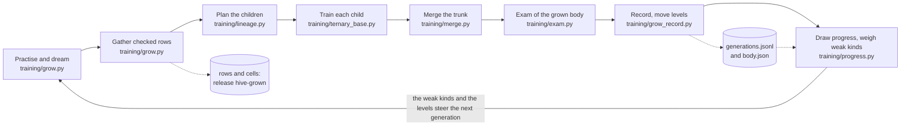
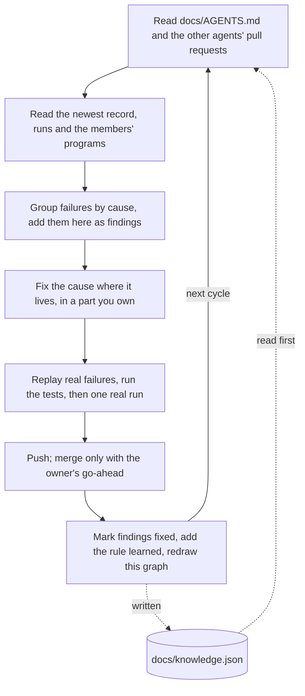
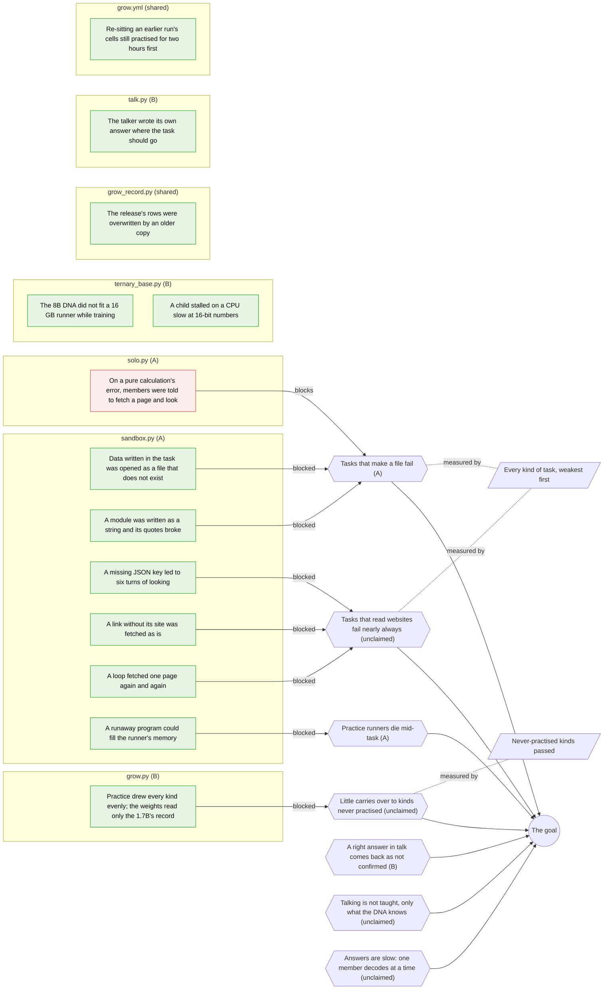

# What is known about HiveMIND

**The goal:** A hive of ternary nets, grown from one DNA, that does what it is asked (questions, conversation, tasks) and gets better at it by itself, generation after generation, on free CPUs.

Drawn from `docs/knowledge.json` by `scripts/knowledge.py`; do not edit this page by hand. Every agent reads the file first and adds to it at the end of a cycle. How the hive is doing in numbers: [PROGRESS.md](PROGRESS.md). Who owns what, and the log of who is doing what: `docs/AGENTS.md`.

## 1. The hive's loop: one generation

It runs by itself on GitHub (`.github/workflows/grow.yml`), one generation after another. Each box names where the step lives.

## 2. The maintainers' loop

Every agent working on the hive follows it, cycle after cycle. Agents on other accounts cannot message each other; this file, `docs/AGENTS.md` and the pull requests are how they work together.

## 3. The knowledge graph

The open problems that stand between the hive and the goal (six-sided), how each is measured (slanted), the causes found in the members' own work (green: fixed, red: still open), each inside the box of the file where it lives, with that file's owner.

## Open problems

| Problem | Owner | Seen |
|---|---|---|
| Tasks that read websites fail nearly always | unclaimed | g27: walk a site 0 of 3, operate a website 0 of 1, facts from sites 0 of 3 |
| Little carries over to kinds never practised | unclaimed | g24 1 of 5, g27 0 of 7 |
| Tasks that make a file fail | A | g27: edit a file 0 of 2, a log into a file 0 of 2, a module 0 of 2 |
| Practice runners die mid-task | A | generations 25 and 28, nothing logged |
| A right answer in talk comes back as not confirmed | B | talk test 2026-11-15: Canberra and 75 days right, the second member did not agree |
| Talking is not taught, only what the DNA knows | unclaimed | no rows for conversation yet |
| Answers are slow: one member decodes at a time | unclaimed | docs/KERNELS.md section 3 |

## Causes found (1 open, 12 fixed)

| Cause | Where | Status | By | Seen |
|---|---|---|---|---|
| On a pure calculation's error, members were told to fetch a page and look | `team/solo.py` | open | A | g27: a robot simulation's IndexError; two members fetched example.com |
| Data written in the task was opened as a file that does not exist | `team/tools/sandbox.py` | fixed | A, PR 56 | g27: 3 tasks, every member, every turn |
| A module was written as a string and its quotes broke | `team/tools/sandbox.py` | fixed | A, PR 56 | g27: rle.py, intervals.py |
| A missing JSON key led to six turns of looking | `team/tools/sandbox.py` | fixed | A, PR 56 | g27: boto3 upload_time |
| A link without its site was fetched as is | `team/tools/sandbox.py` | fixed | A, PR 56 | g27: /author/bob-marley |
| A loop fetched one page again and again | `team/tools/sandbox.py` | fixed | A, PR 56 | g27: quotes pages 1 to 5 |
| A runaway program could fill the runner's memory | `team/tools/sandbox.py` | fixed | A, PR 56 | g25, g28 |
| Practice drew every kind evenly; the weights read only the 1.7B's record | `training/grow.py` | fixed | B, PR 57 | the record of g24 and g27 |
| Re-sitting an earlier run's cells still practised for two hours first | `.github/workflows/grow.yml` | fixed | A, PR 56 | cycle 1 of agent A |
| The 8B DNA did not fit a 16 GB runner while training | `training/ternary_base.py` | fixed | PR 54 | g24: swapping, 30 to 162 s a row |
| A child stalled on a CPU slow at 16-bit numbers | `training/ternary_base.py` | fixed | PR 54 | g25: the data child |
| The release's rows were overwritten by an older copy | `training/grow_record.py` | fixed | PR 53 | g11's 170 rows |
| The talker wrote its own answer where the task should go | `team/talk.py` | fixed | PR 53 | the first real conversation |

## Rules learned

- Read the members' programs, not the score.
- Replay real failures through the changed code before running anything big.
- Before dispatching a workflow, check what each input does and that the run it points at holds what is needed.
- Code written inside a string needs a test that it parses.
- Before fixing, read the other agents' branches and docs/AGENTS.md: on 2026-11-15 two agents fixed the same faults of g27 at once.
- Making every kind of task fetches live pages: a test that makes them all needs offline makers.
- Start long checks in the background and do the next piece of work while they run.

## The parts

| Part | File | Owner | What it does |
|---|---|---|---|
| Practice and dreams | `training/grow.py` | B | fresh tasks at the edge of what the body can do, and the tasks it got wrong before; checked work becomes rows |
| Tasks and their checks | `training/exam.py` | B | every kind of task, made from a seed, with a check that needs no model |
| The members' loop | `team/solo.py` | A | trunk and cells each write and run programs; an answer counts when two agree |
| What a program runs in | `team/tools/sandbox.py` | A | runs a member's program, serves given data, limits memory and time |
| Who has children | `training/lineage.py` | B | every grown cell has one child a generation; the young wait one (Fibonacci) |
| Training a cell | `training/ternary_base.py` | B | the 8B DNA held ternary on a 16 GB runner; a cell is a LoRA edit trained on rows |
| The trunk | `training/merge.py` | B | the newest cell of every line averaged into one edit; it answers first |
| The record and the levels | `training/grow_record.py` | shared | writes each generation's exam to the record, moves lesson levels, joins rows |
| Progress graphs | `training/progress.py` | B | draws the record every generation; its weak kinds steer the next practice |
| Talking with the hive | `team/talk.py` | B | one word decides: talk is answered at once, work goes to the members |
| The ternary runtime | `team/ternary.py` | B | serves the DNA and switches cells per request |
| The line of generations | `.github/workflows/grow.yml` | shared | practise, gather, plan, train, merge, exam, record, then the next generation |

Agents: **A**: Claude, session nice-bell, branch claude/nice-bell-8a5dm4, pull request 56: the members' runtime and loop; **B**: Claude, session vigilant-brahmagupta, branch claude/vigilant-brahmagupta-rz3ab7, pull request 57: training, practice, progress, this graph; **shared**: nobody owns it: small commits, main merged first, said in the log.
