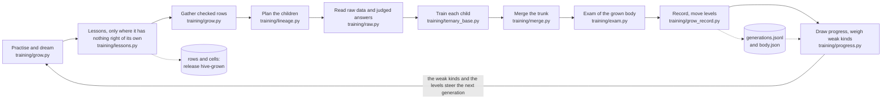
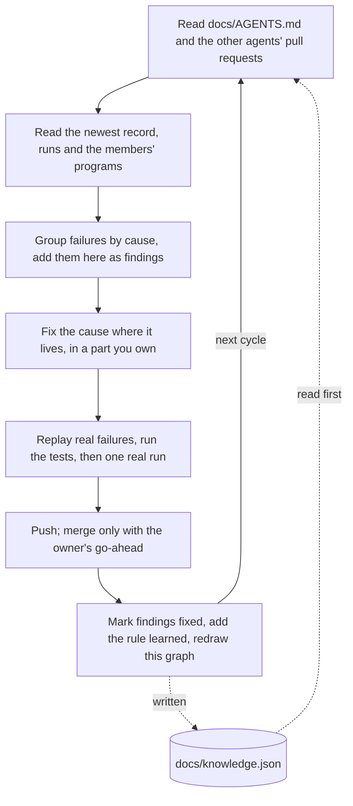

# What is known about HiveMIND

**The goal:** A hive of ternary nets, grown from one DNA, that does what it is asked (questions, conversation, tasks) and gets better at it by itself, generation after generation, on free CPUs.

Drawn from `docs/knowledge.json` by `scripts/knowledge.py`; do not edit this page by hand. Every agent reads the file first and adds to it at the end of a cycle. How the hive is doing in numbers: [PROGRESS.md](PROGRESS.md). Who owns what, and the log of who is doing what: `docs/AGENTS.md`.

## 1. The hive's loop: one generation

It runs by itself on GitHub (`.github/workflows/grow.yml`), one generation after another. Each box names where the step lives.

## 2. The maintainers' loop

Every agent working on the hive follows it, cycle after cycle. Agents on other accounts cannot message each other; this file, `docs/AGENTS.md` and the pull requests are how they work together.

## 3. The knowledge graph

The open problems that stand between the hive and the goal (six-sided), how each is measured (slanted), the causes found in the members' own work (green: fixed, red: still open), each inside the box of the file where it lives, with that file's owner.

```mermaid
flowchart LR
  goal(("The goal"))
  reasoning{{"Members disagree, or two agree on a wrong answer (B)"}}
  reasoning --> goal
  reasoning -.-|measured by| m_score
  reasoning -.-|measured by| m_kinds
  web{{"Tasks that read websites fail nearly always (B)"}}
  web --> goal
  web -.-|measured by| m_kinds
  carryover{{"Little carries over to kinds never practised (unclaimed)"}}
  carryover --> goal
  carryover -.-|measured by| m_carry
  files{{"Tasks that make a file fail (A)"}}
  files --> goal
  files -.-|measured by| m_kinds
  deaths{{"Practice runners die mid-task (A)"}}
  deaths --> goal
  confirm{{"A right answer in talk comes back as not confirmed (B)"}}
  confirm --> goal
  talktaught{{"Talking is not taught, only what the DNA knows (unclaimed)"}}
  talktaught --> goal
  speed{{"Answers are slow: one member decodes at a time (unclaimed)"}}
  speed --> goal
  selflearn{{"The taught body barely beats its untaught DNA: training adds little, the runtime's help does the work (B)"}}
  selflearn --> goal
  slowtraining{{"A child of the 8B takes close to three hours to train on a free runner's CPU (B)"}}
  slowtraining --> goal
  slowtraining -.-|measured by| m_rows
  m_score[/"Exam tasks passed, each generation"/]
  m_carry[/"Never-practised kinds passed"/]
  m_kinds[/"Every kind of task, weakest first"/]
  m_rows[/"Rows taught, each generation"/]
  subgraph p_practice["grow.py (B)"]
    f_dreamonce["A dream took a failed task once; one cell that cannot see through it gave up the task for the night"]:::fixed
    f_flat["Practice drew every kind evenly; the weights read only the 1.7B's record"]:::fixed
  end
  subgraph p_lessons["lessons.py (B)"]
    f_teacherforever["Lessons would have taught every kind for ever, though the hive can learn most from its own work"]:::fixed
    f_typed["Values typed instead of computed ('pocket' backwards as 'etok', 680 less 15% as 528)"]:::fixed
    f_nothingright["A kind never passed had nothing to learn from, so practising it more taught nothing"]:::fixed
    f_nothingrightfiles["The same for tasks that make a file: no right program, no rows"]:::fixed
  end
  subgraph p_raw["raw.py (B)"]
    f_rawoff["Reading raw data and people's judged answers were built and never switched on in the line"]:::fixed
  end
  subgraph p_members["solo.py (A)"]
    f_noheadings["An agreed answer without the PART headings was accepted, so every part failed"]:::open
    f_fetchknown["Members fetched a known fact from addresses they made up"]:::open
    f_lookadvice["On a pure calculation's error, members were told to fetch a page and look"]:::fixed
    f_silentmodule["A module was saved but its member printed nothing and gave up"]:::fixed
    f_defsonly["A program that only defines functions was taken for a typed answer and never run"]:::fixed
    f_emptysearch["A search that found nothing was taken as the answer"]:::fixed
    f_hintlog["The runtime's help was not counted, so learning on its own could not be seen"]:::fixed
  end
  subgraph p_sandbox["sandbox.py (A)"]
    f_given["Data written in the task was opened as a file that does not exist"]:::fixed
    f_module["A module was written as a string and its quotes broke"]:::fixed
    f_jsonkey["A missing JSON key led to six turns of looking"]:::fixed
    f_links["A link without its site was fetched as is"]:::fixed
    f_samepage["A loop fetched one page again and again"]:::fixed
    f_memory["A runaway program could fill the runner's memory"]:::fixed
    f_likekeys["A key that is nowhere in the data was named and nothing more"]:::fixed
    f_htmljson[".json() was called on a web page"]:::fixed
    f_charset["A page that does not say its encoding was read as Latin-1"]:::fixed
    f_useragent["Requests went without a User-Agent and Wikipedia refused them"]:::fixed
    f_badaddress["An address of None, a made-up host, a site glued to its path"]:::fixed
  end
  subgraph p_train["ternary_base.py (B)"]
    f_pairmemory["A judged pair was capped as if it were one answer, though both are held while trained"]:::fixed
    f_oom8b["The 8B DNA did not fit a 16 GB runner while training"]:::fixed
    f_slowcpu["A child stalled on a CPU slow at 16-bit numbers"]:::fixed
  end
  subgraph p_record["grow_record.py (shared)"]
    f_overwrite["The release's rows were overwritten by an older copy"]:::fixed
  end
  subgraph p_talk["talk.py (B)"]
    f_talkerwrote["The talker wrote its own answer where the task should go"]:::fixed
  end
  subgraph p_workflow["grow.yml (shared)"]
    f_resit["Re-sitting an earlier run's cells still practised for two hours first"]:::fixed
  end
  f_rawoff -->|blocked| carryover
  f_pairmemory -->|blocked| carryover
  f_teacherforever -->|blocked| carryover
  f_dreamonce -->|blocked| reasoning
  f_typed -->|blocked| reasoning
  f_noheadings -->|blocks| reasoning
  f_nothingright -->|blocked| web
  f_nothingrightfiles -->|blocked| files
  f_fetchknown -->|blocks| confirm
  f_given -->|blocked| files
  f_module -->|blocked| files
  f_jsonkey -->|blocked| web
  f_links -->|blocked| web
  f_samepage -->|blocked| web
  f_lookadvice -->|blocked| files
  f_memory -->|blocked| deaths
  f_flat -->|blocked| carryover
  f_likekeys -->|blocked| web
  f_htmljson -->|blocked| web
  f_charset -->|blocked| web
  f_useragent -->|blocked| web
  f_badaddress -->|blocked| web
  f_silentmodule -->|blocked| files
  f_defsonly -->|blocked| files
  f_emptysearch -->|blocked| files
  f_hintlog -->|blocked| selflearn
  classDef fixed fill:#e7f4e4,stroke:#0ca30c,color:#0b0b0b
  classDef open fill:#fdecec,stroke:#d03b3b,color:#0b0b0b
```

## Open problems

| Problem | Owner | Seen |
|---|---|---|
| Members disagree, or two agree on a wrong answer | B | g28 practice, 100 tasks: 19 disagreed, 10 agreed on a wrong answer, 16 no answer, 32 right; A counted 45 of 77 failures |
| Tasks that read websites fail nearly always | B | g27: walk a site 0 of 3, operate a website 0 of 1, facts from sites 0 of 3 |
| Little carries over to kinds never practised | unclaimed | g24 1 of 5, g27 0 of 7 |
| Tasks that make a file fail | A | g27: edit a file 0 of 2, a log into a file 0 of 2, a module 0 of 2 |
| Practice runners die mid-task | A | generations 25 and 28, nothing logged |
| A right answer in talk comes back as not confirmed | B | talk test 2026-11-15: Canberra and 75 days right, the second member did not agree |
| Talking is not taught, only what the DNA knows | unclaimed | no rows for conversation yet |
| Answers are slow: one member decodes at a time | unclaimed | docs/KERNELS.md section 3 |
| The taught body barely beats its untaught DNA: training adds little, the runtime's help does the work | B | trial run 31 (same exams): untaught DNA 8 and 7 of 16, the body's cells 10, 7, 10, 8. The levers, all in training: rows from every member the check confirms (rows_of takes only agreed ones; 28 of 77 failures were disagreements, some with a right member); right-against-wrong pairs on (--pairs, built, off); raw reading (--read, built, off). The measure: docs/selfreliance.csv (scripts/selfreliance.py) per generation: right_first_try up, hints_per_task down |
| A child of the 8B takes close to three hours to train on a free runner's CPU | B | g25 to g28: 9 to 18 s a row, 170 minutes a child; on an L4 GPU it is minutes (training/colab.py, waiting for the owner's notebook) |

## Causes found (2 open, 29 fixed)

| Cause | Where | Status | By | Seen |
|---|---|---|---|---|
| An agreed answer without the PART headings was accepted, so every part failed | `team/solo.py` | open | A: the form check could insist on the headings before agreeing | g28 practice: c10002803_03, c10002802_00 (the values right or nearly, the headings missing) |
| Members fetched a known fact from addresses they made up | `team/solo.py` | open | B: lessons now show known facts written into the program (m_know); A: the runtime could say a host does not exist | talk test 2026-11-15: the capital of Australia from api.example.com, all three members |
| Reading raw data and people's judged answers were built and never switched on in the line | `training/raw.py` | fixed | B: every child now reads 40 raw pieces and 10 judged pairs (repository variables HIVE_READ, HIVE_JUDGED) | built 2026-11-14 on the 1.7B, never measured; first run on the 8B here: 36 drawn, measured, 12 kept |
| A judged pair was capped as if it were one answer, though both are held while trained | `training/ternary_base.py` | fixed | B: a pair must fit one row's memory as a whole; judged texts cut to 900 characters | the first 8B test with judged pairs (the machine's limit was the larger cause: see the rule) |
| Lessons would have taught every kind for ever, though the hive can learn most from its own work | `training/lessons.py` | fixed | B: lessons stop for a kind once the hive has 3 right programs of its own | g28 rows: 15 of 23 kinds already had their own right programs; 8 had none (websites, files, the open web) |
| A dream took a failed task once; one cell that cannot see through it gave up the task for the night | `training/grow.py` | fixed | B: two tries, the second with another cell beside the trunk | g28: 5 of 24 dreams corrected in one try |
| Values typed instead of computed ('pocket' backwards as 'etok', 680 less 15% as 528) | `training/lessons.py` | fixed | B, lessons for 12 everyday kinds where every value is computed (213 of 213 right) | g28 practice: two members agreed on 'etok'; 'LANCERN'; 528 for 578; code to be fixed run unchanged |
| A kind never passed had nothing to learn from, so practising it more taught nothing | `training/lessons.py` | fixed | B, lessons: 40 of 40 right on the live sites, tasks of several parts too | g24 to g27: walk a site, operate a website, a log into a file, a module: 0 passed, so 0 rows |
| The same for tasks that make a file: no right program, no rows | `training/lessons.py` | fixed | B, lessons | g27: a log into a file 0 of 2, a module 0 of 2 |
| Data written in the task was opened as a file that does not exist | `team/tools/sandbox.py` | fixed | A, PR 56 | g27: 3 tasks, every member, every turn |
| A module was written as a string and its quotes broke | `team/tools/sandbox.py` | fixed | A, PR 56 | g27: rle.py, intervals.py |
| A missing JSON key led to six turns of looking | `team/tools/sandbox.py` | fixed | A, PR 56 | g27: boto3 upload_time |
| A link without its site was fetched as is | `team/tools/sandbox.py` | fixed | A, PR 56 | g27: /author/bob-marley |
| A loop fetched one page again and again | `team/tools/sandbox.py` | fixed | A, PR 56 | g27: quotes pages 1 to 5 |
| On a pure calculation's error, members were told to fetch a page and look | `team/solo.py` | fixed | A, PR 56 | g27: a robot simulation's IndexError; two members fetched example.com |
| A runaway program could fill the runner's memory | `team/tools/sandbox.py` | fixed | A, PR 56 | g25, g28 |
| Practice drew every kind evenly; the weights read only the 1.7B's record | `training/grow.py` | fixed | B, PR 57 | the record of g24 and g27 |
| Re-sitting an earlier run's cells still practised for two hours first | `.github/workflows/grow.yml` | fixed | A, PR 56 | cycle 1 of agent A |
| The 8B DNA did not fit a 16 GB runner while training | `training/ternary_base.py` | fixed | PR 54 | g24: swapping, 30 to 162 s a row |
| A child stalled on a CPU slow at 16-bit numbers | `training/ternary_base.py` | fixed | PR 54 | g25: the data child |
| The release's rows were overwritten by an older copy | `training/grow_record.py` | fixed | PR 53 | g11's 170 rows |
| The talker wrote its own answer where the task should go | `team/talk.py` | fixed | PR 53 | the first real conversation |
| A key that is nowhere in the data was named and nothing more | `team/tools/sandbox.py` | fixed | A, PR 56 | g28 practice: 'release_date' asked of PyPI in 7 tasks; now the keys like it are named (urls[0].upload_time) |
| .json() was called on a web page | `team/tools/sandbox.py` | fixed | A, PR 56 | g28 practice and the trial: 9 tasks |
| A page that does not say its encoding was read as Latin-1 | `team/tools/sandbox.py` | fixed | A, PR 56 | g28 practice: '£51.77' came as '£51.77' on books.toscrape.com and float() failed |
| Requests went without a User-Agent and Wikipedia refused them | `team/tools/sandbox.py` | fixed | A, PR 56 | g28 practice: 'Please set a user-agent' |
| An address of None, a made-up host, a site glued to its path | `team/tools/sandbox.py` | fixed | A, PR 56 | g28 practice: Invalid URL 'None' twice, api.wikidata.org, books.toscrape.comcatalogue |
| A module was saved but its member printed nothing and gave up | `team/solo.py` | fixed | A, PR 56 | trial of g27's exam: intervals.py saved for two members, no two answers alike |
| A program that only defines functions was taken for a typed answer and never run | `team/solo.py` | fixed | A, PR 56 | found while testing silentmodule |
| A search that found nothing was taken as the answer | `team/solo.py` | fixed | A, PR 56 | trial of g27's exam: 'No ERROR lines found.' on a log full of them |
| The runtime's help was not counted, so learning on its own could not be seen | `team/solo.py` | fixed | A, PR 56 | 2026-11-15: every hint is now named in each task's events (team/solo.HINTS) and counted by scripts/selfreliance.py |

## Rules learned

- Read the members' programs, not the score.
- Replay real failures through the changed code before running anything big.
- Before dispatching a workflow, check what each input does and that the run it points at holds what is needed.
- Code written inside a string needs a test that it parses.
- Before fixing, read the other agents' branches and docs/AGENTS.md: on 2026-11-15 two agents fixed the same faults of g27 at once.
- Making every kind of task fetches live pages: a test that makes them all needs offline makers.
- Start long checks in the background and do the next piece of work while they run.
- A kind the hive never passes cannot be learned from its own work: show it a right program, checked by the task's own check, then let practice take over.
- The hive learns from its own checked work first; a lesson only starts a kind where it has nothing right of its own, and stops when it has.
- Measure memory on a machine like the runner: this sandbox kills a process near 13 GB, the runners give 15.6 GB and the 8B's training peaks at 14.8 GB there. A kill here may be the machine, not the change: run the baseline beside it.
- Classify every failure in every artifact at once, then fix all the causes in one pass: one cycle on 132 tasks found six causes that one task at a time would have taken six cycles.
- Write code meant for a string (the program hook) as plain code, and escape it by program when inserting it.

## The parts

| Part | File | Owner | What it does |
|---|---|---|---|
| Practice and dreams | `training/grow.py` | B | fresh tasks at the edge of what the body can do, and the tasks it got wrong before; checked work becomes rows |
| Lessons | `training/lessons.py` | B | a right program for fresh tasks of every kind the hive cannot do yet and for tasks it got wrong, each checked by the task's own check before it is taught |
| Reading raw data | `training/raw.py` | B | web pages, Wikipedia, open code and real code fixes, each measured by the DNA's own error and only the middle band read; answers people voted on, best beside worst |
| The owner's Colab GPU | `training/colab.py` | B | while the owner's notebook (colab/hive_gpu.ipynb) runs, each child is trained on its GPU in minutes, ordered and returned through the release; without it the runner trains as always |
| Tasks and their checks | `training/exam.py` | B | every kind of task, made from a seed, with a check that needs no model |
| The members' loop | `team/solo.py` | A | trunk and cells each write and run programs; an answer counts when two agree |
| What a program runs in | `team/tools/sandbox.py` | A | runs a member's program, serves given data, limits memory and time |
| Who has children | `training/lineage.py` | B | every grown cell has one child a generation; the young wait one (Fibonacci) |
| Training a cell | `training/ternary_base.py` | B | the 8B DNA held ternary on a 16 GB runner; a cell is a LoRA edit trained on rows |
| The trunk | `training/merge.py` | B | the newest cell of every line averaged into one edit; it answers first |
| The record and the levels | `training/grow_record.py` | shared | writes each generation's exam to the record, moves lesson levels, joins rows |
| Progress graphs | `training/progress.py` | B | draws the record every generation; its weak kinds steer the next practice |
| Talking with the hive | `team/talk.py` | B | one word decides: talk is answered at once, work goes to the members |
| The ternary runtime | `team/ternary.py` | B | serves the DNA and switches cells per request |
| The line of generations | `.github/workflows/grow.yml` | shared | practise, gather, plan, train, merge, exam, record, then the next generation |

Agents: **A**: Claude, session nice-bell, branch claude/nice-bell-8a5dm4, pull request 56: the members' runtime and loop; **B**: Claude, session vigilant-brahmagupta, branch claude/vigilant-brahmagupta-rz3ab7: training, practice, lessons, progress, talking, this graph; the website problem; **shared**: nobody owns it: small commits, main merged first, said in the log.
