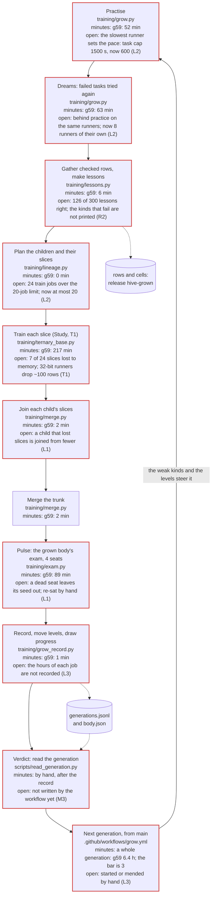
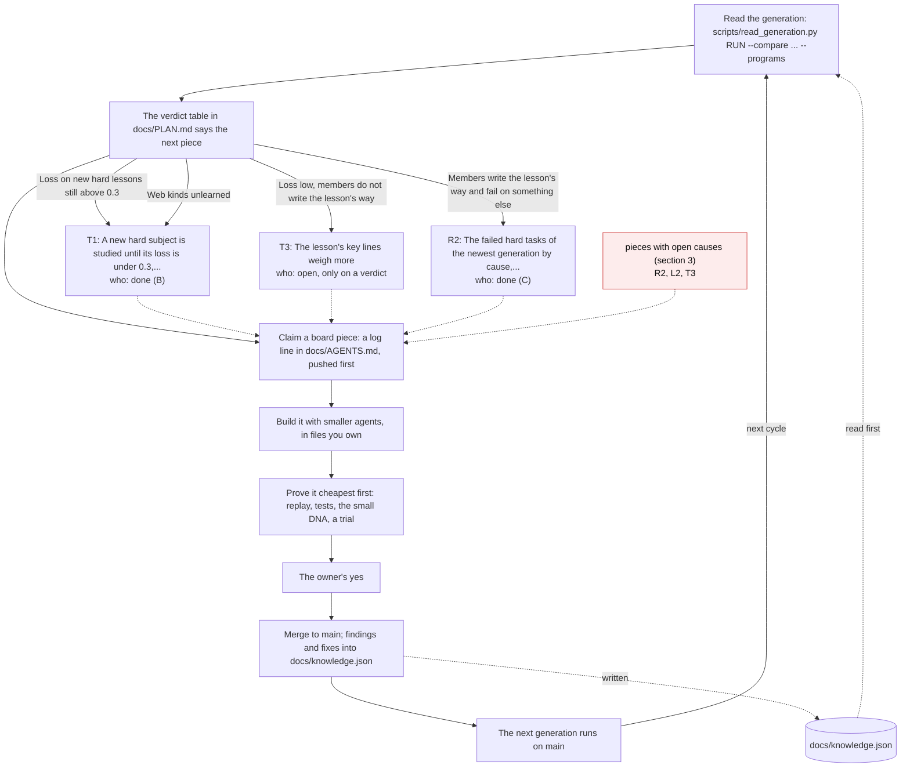

# What is known about HiveMIND

**The goal:** A hive of ternary nets, grown from one DNA, that does what it is asked (questions, conversation, tasks) and gets better at it by itself, generation after generation, on free CPUs.

Drawn from `docs/knowledge.json` (and the board and verdict table of `docs/PLAN.md`) by `scripts/knowledge.py`; do not edit this page by hand. Every agent reads the file first and adds to it at the end of a cycle. How the hive is doing in numbers: [PROGRESS.md](PROGRESS.md). Who owns what, and the log of who is doing what: `docs/AGENTS.md`.

## 1. The hive's loop: one generation

It runs by itself on GitHub (`.github/workflows/grow.yml`), one generation after another. Each box names where the step lives, the minutes it was measured to take, and its open problem with the board piece that owns it (red border: a problem is open).

## 2. The agents' loop

Every agent working on the hive follows it, generation after generation. The verdict's branches are the rows of the verdict table in `docs/PLAN.md`; the red box lists the board pieces that still hold an open cause (section 3). Agents on other accounts cannot message each other; this file, `docs/AGENTS.md` and the pull requests are how they work together.

## 3. Findings, causes, fixes and the board

What was seen (slanted) -> its cause -> its fix -> the board piece of `docs/PLAN.md` it belongs to. Green: fixed; red: still open (a red piece holds at least one open cause).

```mermaid
flowchart LR
  pc_L3["L3: The line runs five generations with nobody's hand<br/>who: done (B)"]:::fixed
  pc_T3["T3: The lesson's key lines weigh more<br/>who: open, only on a verdict"]:::open
  pc_L1["L1: Generation 38 through<br/>who: done (B)"]:::fixed
  pc_L2["L2: A generation in 5 hours with no less work<br/>who: done (B, g43 4.4 h)"]:::open
  pc_T1["T1: A new hard subject is studied until its loss is under 0.3,...<br/>who: done (B)"]:::fixed
  pc_T2["T2: Lessons kept back<br/>who: done (B)"]:::fixed
  pc_T4["T4: No hard lesson lost to the length limit<br/>who: done (B)"]:::fixed
  pc_R2["R2: The failed hard tasks of the newest generation by cause,...<br/>who: done (C)"]:::open
  s_scheduledup[/"a 'schedule' run duplicated the self-restarting line"/]
  c_scheduledup["The nightly schedule started a second run of the line beside the one that restarts itself after each record"]:::fixed
  x_scheduledup(["fresh ends a scheduled run when a run of the line started or ended within 8 hours, and any line run when a newer one is already under way (tests/test_fresh_run.py)"]):::fixed
  s_scheduledup --> c_scheduledup --> x_scheduledup --> pc_L3
  s_stalebody[/"g35's record conflicted with g34's"/]
  c_stalebody["A scheduled run queued behind a running generation grew from the body before it and its record conflicted"]:::fixed
  x_stalebody(["the first job (fresh) ends a stale run"]):::fixed
  s_stalebody --> c_stalebody --> x_stalebody --> pc_L3
  s_modulestring[/"g35: module tasks failed with ''.join turned into .join"/]
  c_modulestring["Members wrote a module as f.write() strings and broke their own quotes"]:::open
  x_modulestring(["no fix yet"]):::open
  s_modulestring --> c_modulestring --> x_modulestring --> pc_T3
  s_cpuflags[/"model server exit -4 (illegal instruction) on every start"/]
  c_cpuflags["The runtime kept for one CPU was used on another of the same name that lacks some of its instructions"]:::fixed
  x_cpuflags(["the kept runtime keyed by the CPU's instruction list (PR 73)"]):::fixed
  s_cpuflags --> c_cpuflags --> x_cpuflags --> pc_L1
  s_g35sibling[/"g35 beside g34: hard 6 of 24 against 6 of 32"/]
  c_g35sibling["g35 trained from g28's body beside g34: the night's changes against the old way, same parents"]:::fixed
  x_g35sibling(["read as a trial, not a generation"]):::fixed
  s_g35sibling --> c_g35sibling --> x_g35sibling --> pc_L1
  s_serverdeath[/"a pulse seat's server ended at once"/]
  c_serverdeath["A gate runner's model server ended at once on every start, reported as 'did not come up in 600 s'"]:::fixed
  x_serverdeath(["the server says its exit code; logs kept (PR 61)"]):::fixed
  s_serverdeath --> c_serverdeath --> x_serverdeath --> pc_L1
  s_slicememory[/"g38: 7 of 24 train slices lost, g39: 5 of 20, 46-133 min in; survivors at 14.1-14.8 of 15.6 GB"/]
  c_slicememory["The row-length formula missed 1.5-1.9 GB (scratch buffers, optimizer state, the OS: it used the total at load), so 8B slices ran at the runner's RAM ceiling and swapped when a new longest row came; Xeon 6975P-C runners suspected (0 of 32 survivors)"]:::fixed
  x_slicememory(["a memory guard that measures: a row that would leave under 1 GB available is skipped for that pass, the cost of a piece learned from the run"]):::fixed
  s_slicememory --> c_slicememory --> x_slicememory --> pc_L1
  s_colaball[/"Colab offered all ~6 children of g38 at once"/]
  c_colaball["The hand-off offered all of a generation's children to the notebook at once, which grows one at a time"]:::fixed
  x_colaball(["only K children offered (HIVE_COLAB_CHILDREN, PR 74)"]):::fixed
  s_colaball --> c_colaball --> x_colaball --> pc_L2
  s_colabtiming[/"the owner's L4 notebook came up 13 minutes after g42's training began; no train job looked again, so it grew nothing"/]
  c_colabtiming["The notebook never trained a child: each train job looked for it only once, at the job's start"]:::fixed
  x_colabtiming(["the child offered waits up to HIVE_COLAB_WAIT minutes (15) for the notebook; slice 0 orders, the other slices stand aside on the order; no wait when it was not seen in 12 hours"]):::fixed
  s_colabtiming --> c_colabtiming --> x_colabtiming --> pc_L2
  s_practicetail[/"g38 practice 134 min, its slowest runner 47 min of dreams + 84 of tasks"/]
  c_practicetail["Practice waited on its slowest runner: dreams on the same runners and a 1500 s task cap"]:::fixed
  x_practicetail(["dreams on 8 runners of their own, 600 s task cap (L2)"]):::fixed
  s_practicetail --> c_practicetail --> x_practicetail --> pc_L2
  s_rawmeasure[/"raw measuring 22-26 of a slice's 170 min (59-61 on 32-bit runners)"/]
  c_rawmeasure["Measuring raw text by the DNA's own error takes an eighth of a slice's time"]:::open
  x_rawmeasure(["no fix yet"]):::open
  s_rawmeasure --> c_rawmeasure --> x_rawmeasure --> pc_L2
  s_twowaves[/"g38: 8 children x 3 slices = 24 jobs over the 20-job limit"/]
  c_twowaves["24 train jobs where only 20 run at once: 4 slices waited for a second wave"]:::fixed
  x_twowaves(["at most 20 train jobs, uneven slices (L2)"]):::fixed
  s_twowaves --> c_twowaves --> x_twowaves --> pc_L2
  s_fewpasses[/"new hard lessons end at loss 0.4-1.6"/]
  c_fewpasses["New hard lessons ended training at a loss of 0.4 to 1.6: too few passes, web kinds least"]:::fixed
  x_fewpasses(["Study: a new hard subject at loss 0.3 or more gets 3 in 4 passes, web kinds first (T1)"]):::fixed
  s_fewpasses --> c_fewpasses --> x_fewpasses --> pc_T1
  s_keptback[/"no lesson was ever kept out of training"/]
  c_keptback["A loss on rows a cell trained on can fall by learning them by heart: nothing showed whether a kind was learned"]:::fixed
  x_keptback(["2 lessons a kind kept back, their loss before and after in each slice's record (T2)"]):::fixed
  s_keptback --> c_keptback --> x_keptback --> pc_T2
  s_leftoutmeasure[/"g41's read named T4 for 'a fact read and a date sum on it' (57 of 152) and 'several facts laid out as a file' (71 of 342); T4 measured those kinds' lessons at 0 rows over 508 pieces"/]
  c_leftoutmeasure["The read's 'rows left out' counted rows not reached in time and skipped for memory as too long"]:::fixed
  x_leftoutmeasure(["rows_by_kind in the slice record; rule 2 on too-long rows only; older records shown as an estimate that holds no rule"]):::fixed
  s_leftoutmeasure --> c_leftoutmeasure --> x_leftoutmeasure --> pc_T4
  s_loglesson[/"log lessons median 1300 pieces: 6 of 15 left out, all 15 in 32 bits"/]
  c_loglesson["The log lesson copies the log into its program, so it is too long to be taught"]:::fixed
  x_loglesson(["the log lesson reads log.txt and its rows show 5 lines of the log"]):::fixed
  s_loglesson --> c_loglesson --> x_loglesson --> pc_T4
  s_rows32[/"32-bit runners (EPYC 7763) drop ~100 of 700-800 rows"/]
  c_rows32["Runners that train in 32 bits leave out every row over about 500 pieces"]:::fixed
  x_rows32(["lessons fit 508 pieces: short programs, drawn again when too long, fix rows cut"]):::fixed
  s_rows32 --> c_rows32 --> x_rows32 --> pc_T4
  s_lessonswrong[/"g38 gather: 126 of 300 lessons right"/]
  c_lessonswrong["Most lessons made for a generation fail their own check, and the step does not say which kinds"]:::open
  x_lessonswrong(["no fix yet"]):::open
  s_lessonswrong --> c_lessonswrong --> x_lessonswrong --> pc_R2
  classDef fixed fill:#e7f4e4,stroke:#0ca30c,color:#0b0b0b
  classDef open fill:#fdecec,stroke:#d03b3b,color:#0b0b0b
```

## 4. Where the causes live

The open problems that stand between the hive and the goal (six-sided), how each is measured (slanted), the causes found in the members' own work (green: fixed, red: still open), each inside the box of the file where it lives, with that file's owner.

```mermaid
flowchart LR
  goal(("The goal"))
  reasoning{{"Members disagree, or two agree on a wrong answer (B)"}}
  reasoning --> goal
  reasoning -.-|measured by| m_score
  reasoning -.-|measured by| m_kinds
  web{{"Tasks that read websites fail nearly always (B)"}}
  web --> goal
  web -.-|measured by| m_kinds
  carryover{{"Little carries over to kinds never practised (unclaimed)"}}
  carryover --> goal
  carryover -.-|measured by| m_carry
  files{{"Tasks that make a file fail (A)"}}
  files --> goal
  files -.-|measured by| m_kinds
  deaths{{"Practice runners die mid-task (B)"}}
  deaths --> goal
  confirm{{"A right answer in talk comes back as not confirmed (B)"}}
  confirm --> goal
  talktaught{{"Talking is not taught, only what the DNA knows (unclaimed)"}}
  talktaught --> goal
  speed{{"Answers are slow: one member decodes at a time (unclaimed)"}}
  speed --> goal
  selflearn{{"The taught body barely beats its untaught DNA: training adds little, the runtime's help does the work (B)"}}
  selflearn --> goal
  slowtraining{{"A child of the 8B takes close to three hours to train on a free runner's CPU (B)"}}
  slowtraining --> goal
  slowtraining -.-|measured by| m_rows
  hardkinds{{"Hard kinds with lessons are never learned (B)"}}
  hardkinds --> goal
  hardkinds -.-|measured by| m_split
  hardkinds -.-|measured by| m_kinds
  slowgeneration{{"A generation takes 8 to 10 hours; the bar is 5 (B)"}}
  slowgeneration --> goal
  slowgeneration -.-|measured by| m_hours
  m_score[/"Exam tasks passed, each generation"/]
  m_carry[/"Never-practised kinds passed"/]
  m_kinds[/"Every kind of task, weakest first"/]
  m_rows[/"Rows taught, each generation"/]
  m_split[/"Hard, easy and held-out kinds passed, each generation"/]
  m_hours[/"Hours of one generation, by step"/]
  subgraph p_practice["grow.py (B)"]
    f_agreedonly["Only members that agreed were taught, though the task's own check confirms each member"]:::fixed
    f_dreamonce["A dream took a failed task once; one cell that cannot see through it gave up the task for the night"]:::fixed
    f_flat["Practice drew every kind evenly; the weights read only the 1.7B's record"]:::fixed
    f_evenpractice["Practice weighs a kind passed 2 of 2 and one passed 0 of 2 the same, so half of it goes to kinds already learned"]:::fixed
    f_practicetail["Practice waited on its slowest runner: dreams on the same runners and a 1500 s task cap"]:::fixed
    f_slicememory["The row-length formula missed 1.5-1.9 GB (scratch buffers, optimizer state, the OS: it used the total at load), so 8B slices ran at the runner's RAM ceiling and swapped when a new longest row came; Xeon 6975P-C runners suspected (0 of 32 survivors)"]:::fixed
    f_fewpasses["New hard lessons ended training at a loss of 0.4 to 1.6: too few passes, web kinds least"]:::fixed
    f_keptback["A loss on rows a cell trained on can fall by learning them by heart: nothing showed whether a kind was learned"]:::fixed
  end
  subgraph p_lessons["lessons.py (B)"]
    f_teacherforever["Lessons would have taught every kind for ever, though the hive can learn most from its own work"]:::fixed
    f_typed["Values typed instead of computed ('pocket' backwards as 'etok', 680 less 15% as 528)"]:::fixed
    f_nothingright["A kind never passed had nothing to learn from, so practising it more taught nothing"]:::fixed
    f_nothingrightfiles["The same for tasks that make a file: no right program, no rows"]:::fixed
    f_lessonswrong["Most lessons made for a generation fail their own check, and the step does not say which kinds"]:::open
    f_loglesson["The log lesson copies the log into its program, so it is too long to be taught"]:::fixed
    f_k2nolessons["Most K2 kinds with no lessons are held out or left to the hive by design; three text kinds' rows held their text twice"]:::fixed
  end
  subgraph p_raw["raw.py (B)"]
    f_rawoff["Reading raw data and people's judged answers were built and never switched on in the line"]:::fixed
    f_rawmeasure["Measuring raw text by the DNA's own error takes an eighth of a slice's time"]:::open
  end
  subgraph p_colab["colab.py (B)"]
    f_colaball["The hand-off offered all of a generation's children to the notebook at once, which grows one at a time"]:::fixed
    f_colabtiming["The notebook never trained a child: each train job looked for it only once, at the job's start"]:::fixed
  end
  subgraph p_exam["exam.py (B)"]
    f_orphans["A task out of time left its program running, unwatched, and the runner starved"]:::fixed
    f_undelivered["A cell can pass the job while the hive withholds the file"]:::open
    f_retainedmethods["An unchanged score can hide old skills that a later hive loses"]:::open
  end
  subgraph p_members["solo.py (A)"]
    f_noheadings["An agreed answer without the PART headings was accepted, so every part failed"]:::fixed
    f_fetchknown["Members fetched a known fact from addresses they made up"]:::open
    f_lookadvice["On a pure calculation's error, members were told to fetch a page and look"]:::fixed
    f_silentmodule["A module was saved but its member printed nothing and gave up"]:::fixed
    f_defsonly["A program that only defines functions was taken for a typed answer and never run"]:::fixed
    f_emptysearch["A search that found nothing was taken as the answer"]:::fixed
    f_hintlog["The runtime's help was not counted, so learning on its own could not be seen"]:::fixed
    f_modulestring["Members wrote a module as f.write() strings and broke their own quotes"]:::open
    f_g48practicecauses["New kinds' first try is lost to the time cap, a guard word in data, doubled part headings and retyped data"]:::fixed
    f_heldoutnear["Never-taught kinds fail mostly near a pass: shape, a pasted template, a helper overwritten"]:::open
  end
  subgraph p_sandbox["sandbox.py (A)"]
    f_given["Data written in the task was opened as a file that does not exist"]:::fixed
    f_module["A module was written as a string and its quotes broke"]:::fixed
    f_jsonkey["A missing JSON key led to six turns of looking"]:::fixed
    f_links["A link without its site was fetched as is"]:::fixed
    f_samepage["A loop fetched one page again and again"]:::fixed
    f_memory["A runaway program could fill the runner's memory"]:::fixed
    f_likekeys["A key that is nowhere in the data was named and nothing more"]:::fixed
    f_htmljson[".json() was called on a web page"]:::fixed
    f_charset["A page that does not say its encoding was read as Latin-1"]:::fixed
    f_useragent["Requests went without a User-Agent and Wikipedia refused them"]:::fixed
    f_badaddress["An address of None, a made-up host, a site glued to its path"]:::fixed
  end
  subgraph p_train["ternary_base.py (B)"]
    f_onethird["A child got through a third of its rows, once, in its time on one runner"]:::fixed
    f_pairmemory["A judged pair was capped as if it were one answer, though both are held while trained"]:::fixed
    f_oom8b["The 8B DNA did not fit a 16 GB runner while training"]:::fixed
    f_slowcpu["A child stalled on a CPU slow at 16-bit numbers"]:::fixed
    f_learnedrows["Training passes go to rows the cells already know: loss 0.05, nothing left to learn there"]:::fixed
    f_rows32["Runners that train in 32 bits leave out every row over about 500 pieces"]:::fixed
  end
  subgraph p_record["grow_record.py (shared)"]
    f_overwrite["The release's rows were overwritten by an older copy"]:::fixed
    f_leftoutmeasure["The read's 'rows left out' counted rows not reached in time and skipped for memory as too long"]:::fixed
  end
  subgraph p_talk["talk.py (B)"]
    f_talkerwrote["The talker wrote its own answer where the task should go"]:::fixed
  end
  subgraph p_runtime["ternary.py (B)"]
    f_serverdeath["A gate runner's model server ended at once on every start, reported as 'did not come up in 600 s'"]:::fixed
  end
  subgraph p_workflow["grow.yml (shared)"]
    f_resit["Re-sitting an earlier run's cells still practised for two hours first"]:::fixed
    f_smallpulse["A pulse of 32 tasks cannot show one generation better than the last"]:::fixed
    f_g35sibling["g35 trained from g28's body beside g34: the night's changes against the old way, same parents"]:::fixed
    f_stalebody["A scheduled run queued behind a running generation grew from the body before it and its record conflicted"]:::fixed
    f_scheduledup["The nightly schedule started a second run of the line beside the one that restarts itself after each record"]:::fixed
    f_twowaves["24 train jobs where only 20 run at once: 4 slices waited for a second wave"]:::fixed
  end
  subgraph p_setup["action.yml (shared)"]
    f_cpuflags["The runtime kept for one CPU was used on another of the same name that lacks some of its instructions"]:::fixed
  end
  f_orphans -->|blocked| deaths
  f_agreedonly -->|blocked| reasoning
  f_onethird -->|blocked| slowtraining
  f_rawoff -->|blocked| carryover
  f_pairmemory -->|blocked| carryover
  f_teacherforever -->|blocked| carryover
  f_dreamonce -->|blocked| reasoning
  f_typed -->|blocked| reasoning
  f_noheadings -->|blocked| reasoning
  f_nothingright -->|blocked| web
  f_nothingrightfiles -->|blocked| files
  f_fetchknown -->|blocks| confirm
  f_given -->|blocked| files
  f_module -->|blocked| files
  f_jsonkey -->|blocked| web
  f_links -->|blocked| web
  f_samepage -->|blocked| web
  f_lookadvice -->|blocked| files
  f_memory -->|blocked| deaths
  f_flat -->|blocked| carryover
  f_likekeys -->|blocked| web
  f_htmljson -->|blocked| web
  f_charset -->|blocked| web
  f_useragent -->|blocked| web
  f_badaddress -->|blocked| web
  f_silentmodule -->|blocked| files
  f_defsonly -->|blocked| files
  f_emptysearch -->|blocked| files
  f_hintlog -->|blocked| selflearn
  f_learnedrows -->|blocked| selflearn
  f_evenpractice -->|blocked| selflearn
  f_smallpulse -->|blocked| selflearn
  f_g35sibling -->|blocked| selflearn
  f_serverdeath -->|blocked| deaths
  f_stalebody -->|blocked| deaths
  f_scheduledup -->|blocked| deaths
  f_cpuflags -->|blocked| deaths
  f_colaball -->|blocked| slowgeneration
  f_colabtiming -->|blocked| slowgeneration
  f_twowaves -->|blocked| slowgeneration
  f_practicetail -->|blocked| slowgeneration
  f_slicememory -->|blocked| deaths
  f_fewpasses -->|blocked| hardkinds
  f_keptback -->|blocked| hardkinds
  f_lessonswrong -->|blocks| hardkinds
  f_rows32 -->|blocked| hardkinds
  f_loglesson -->|blocked| hardkinds
  f_rawmeasure -->|blocks| slowgeneration
  f_modulestring -->|blocks| files
  f_leftoutmeasure -->|blocked| hardkinds
  f_undelivered -->|blocks| hardkinds
  f_retainedmethods -->|blocks| hardkinds
  f_g48practicecauses -->|blocked| confirm
  f_k2nolessons -->|blocked| hardkinds
  f_heldoutnear -->|blocks| hardkinds
  classDef fixed fill:#e7f4e4,stroke:#0ca30c,color:#0b0b0b
  classDef open fill:#fdecec,stroke:#d03b3b,color:#0b0b0b
```

## Open problems

| Problem | Owner | Seen |
|---|---|---|
| Members disagree, or two agree on a wrong answer | B | g28 practice, 100 tasks: 19 disagreed, 10 agreed on a wrong answer, 16 no answer, 32 right; A counted 45 of 77 failures |
| Tasks that read websites fail nearly always | B | g27: walk a site 0 of 3, operate a website 0 of 1, facts from sites 0 of 3 |
| Little carries over to kinds never practised | unclaimed | g24 1 of 5, g27 0 of 7 |
| Tasks that make a file fail | A | g27: edit a file 0 of 2, a log into a file 0 of 2, a module 0 of 2 |
| Practice runners die mid-task | B | generations 25 and 28, nothing logged |
| A right answer in talk comes back as not confirmed | B | talk test 2026-11-15: Canberra and 75 days right, the second member did not agree |
| Talking is not taught, only what the DNA knows | unclaimed | no rows for conversation yet |
| Answers are slow: one member decodes at a time | unclaimed | docs/KERNELS.md section 3 |
| The taught body barely beats its untaught DNA: training adds little, the runtime's help does the work | B | trial run 31 (same exams): untaught DNA 8 and 7 of 16, the body's cells 10, 7, 10, 8. The levers, all in training: rows from every member the check confirms (rows_of takes only agreed ones; 28 of 77 failures were disagreements, some with a right member); right-against-wrong pairs on (--pairs, built, off); raw reading (--read, built, off). The measure: docs/selfreliance.csv (scripts/selfreliance.py) per generation: right_first_try up, hints_per_task down |
| A child of the 8B takes close to three hours to train on a free runner's CPU | B | g25 to g28: 9 to 18 s a row, 170 minutes a child; on an L4 GPU it is minutes (training/colab.py, waiting for the owner's notebook) |
| Hard kinds with lessons are never learned | B | g34 hard 6 of 32 (5 of 23 tasks of the nine kinds with lessons, 1 of 9 held out); g35 beside it gained nothing on hard |
| A generation takes 8 to 10 hours; the bar is 5 | B | g35 402 min (practice 160, train 175, pulse 60); g34 about 8 h; g38 about 9-10 h (two waves of training) |

## Causes found (7 open, 53 fixed)

| Cause | Where | Piece | Status | By | Seen |
|---|---|---|---|---|---|
| Members fetched a known fact from addresses they made up | `team/solo.py` |  | open | B: lessons now show known facts written into the program (m_know); A: the runtime could say a host does not exist | talk test 2026-11-15: the capital of Australia from api.example.com, all three members |
| Most lessons made for a generation fail their own check, and the step does not say which kinds | `training/lessons.py` | R2 | open |  | 2026-11-16 23:31: 300 lessons made, 126 right by their checks (258 rows); 13 kinds left to the hive's own rows; read at the verdict |
| Measuring raw text by the DNA's own error takes an eighth of a slice's time | `training/raw.py` | L2 | open |  | 2026-11-16 23:09, the job logs of g33, g35 and g38 |
| Members wrote a module as f.write() strings and broke their own quotes | `team/solo.py` | T3 | open |  | 2026-11-16 22:55, A's read of g35: g35 made no module lessons; the lesson writes the module with inspect.getsource; g38 says whether members now write it the lesson's way |
| A cell can pass the job while the hive withholds the file | `training/exam.py` |  | open | The recorder now counts both grades on the same jobs and reports coverage. | In four G47 hard jobs exactly one member passed and the hive abstained. In twelve others all members failed. All 16 grade archives were verified in training/reports/checked-delivery/g47-headroom.json. |
| An unchanged score can hide old skills that a later hive loses | `training/exam.py` |  | open | The generation recorder now compares individual deliveries on identical prompts and exam revisions. | A task-category selector also scored 47 of 64. On specified invoice work orders, checking different saved methods against the current examples improved correct delivery decisions from 3 of 6 to 6 of 6. |
| Never-taught kinds fail mostly near a pass: shape, a pasted template, a helper overwritten | `team/solo.py` |  | open | h1_causes.py over g51's held-after and gate-work-after artifacts, every failed task's last programs read. | lesson template `key, col = 'name', 'city'` pasted (int('Lima')), a one-value helper called twice with the second overwriting, dict or list dumped for asked lines; 3 tasks each, the same causes as g48's taught kinds. |
| A task out of time left its program running, unwatched, and the runner starved | `training/exam.py` |  | fixed | B's sub-agent: a task out of time ends every process it started (the servers aside); a silent or dead server is started again, at most 3 times a task, with memory free said in the log | trial 32's exam job 132969873608 and g28 practice runner 4: tasks ran out of time, then the server went silent, then GitHub shut the runner down; the 1.7B here: server killed, the next request answered in 3 s |
| Only members that agreed were taught, though the task's own check confirms each member | `training/grow.py` |  | fixed | B's sub-agent: every member the check confirms gives rows; a confirmed member is never the rejected one of a pair | g28 practice (80 tasks in hand): 3 failed tasks had a right member, 9 right members beyond the agreeing ones, 1 agreeing member refused by the check |
| A child got through a third of its rows, once, in its time on one runner | `training/ternary_base.py` |  | fixed | B: each child grown on 3 runners at once, each on its own slice of the rows, the slices averaged into it (training/merge.py join); on the owner's Colab GPU, whole | g28words: 20.7 s a row, 0.38 passes over 1001 rows in 170 minutes (agent A's count); the 1.7B test: 2 slices joined, 0.9998 of the edit kept |
| Reading raw data and people's judged answers were built and never switched on in the line | `training/raw.py` |  | fixed | B: every child now reads 40 raw pieces and 10 judged pairs (repository variables HIVE_READ, HIVE_JUDGED) | built 2026-11-14 on the 1.7B, never measured; first run on the 8B here: 36 drawn, measured, 12 kept |
| A judged pair was capped as if it were one answer, though both are held while trained | `training/ternary_base.py` |  | fixed | B: a pair must fit one row's memory as a whole; judged texts cut to 900 characters | the first 8B test with judged pairs (the machine's limit was the larger cause: see the rule) |
| Lessons would have taught every kind for ever, though the hive can learn most from its own work | `training/lessons.py` |  | fixed | B: lessons stop for a kind once the hive has 3 right programs of its own | g28 rows: 15 of 23 kinds already had their own right programs; 8 had none (websites, files, the open web) |
| A dream took a failed task once; one cell that cannot see through it gave up the task for the night | `training/grow.py` |  | fixed | B: two tries, the second with another cell beside the trunk | g28: 5 of 24 dreams corrected in one try |
| Values typed instead of computed ('pocket' backwards as 'etok', 680 less 15% as 528) | `training/lessons.py` |  | fixed | B, lessons for 12 everyday kinds where every value is computed (213 of 213 right) | g28 practice: two members agreed on 'etok'; 'LANCERN'; 528 for 578; code to be fixed run unchanged |
| An agreed answer without the PART headings was accepted, so every part failed | `team/solo.py` |  | fixed | B's sub-agent: agreement on a task of several parts counts only with every heading; members asked once more, plainly (a comment prints nothing) | g28 practice: 40 tasks of several parts, 3 agreed without any heading (2 lost only to that: c10002803_03, c10002803_04) |
| A kind never passed had nothing to learn from, so practising it more taught nothing | `training/lessons.py` |  | fixed | B, lessons: 40 of 40 right on the live sites, tasks of several parts too | g24 to g27: walk a site, operate a website, a log into a file, a module: 0 passed, so 0 rows |
| The same for tasks that make a file: no right program, no rows | `training/lessons.py` |  | fixed | B, lessons | g27: a log into a file 0 of 2, a module 0 of 2 |
| Data written in the task was opened as a file that does not exist | `team/tools/sandbox.py` |  | fixed | A, PR 56 | g27: 3 tasks, every member, every turn |
| A module was written as a string and its quotes broke | `team/tools/sandbox.py` |  | fixed | A, PR 56 | g27: rle.py, intervals.py |
| A missing JSON key led to six turns of looking | `team/tools/sandbox.py` |  | fixed | A, PR 56 | g27: boto3 upload_time |
| A link without its site was fetched as is | `team/tools/sandbox.py` |  | fixed | A, PR 56 | g27: /author/bob-marley |
| A loop fetched one page again and again | `team/tools/sandbox.py` |  | fixed | A, PR 56 | g27: quotes pages 1 to 5 |
| On a pure calculation's error, members were told to fetch a page and look | `team/solo.py` |  | fixed | A, PR 56 | g27: a robot simulation's IndexError; two members fetched example.com |
| A runaway program could fill the runner's memory | `team/tools/sandbox.py` |  | fixed | A, PR 56 | g25, g28 |
| Practice drew every kind evenly; the weights read only the 1.7B's record | `training/grow.py` |  | fixed | B, PR 57 | the record of g24 and g27 |
| Re-sitting an earlier run's cells still practised for two hours first | `.github/workflows/grow.yml` |  | fixed | A, PR 56 | cycle 1 of agent A |
| The 8B DNA did not fit a 16 GB runner while training | `training/ternary_base.py` |  | fixed | PR 54 | g24: swapping, 30 to 162 s a row |
| A child stalled on a CPU slow at 16-bit numbers | `training/ternary_base.py` |  | fixed | PR 54 | g25: the data child |
| The release's rows were overwritten by an older copy | `training/grow_record.py` |  | fixed | PR 53 | g11's 170 rows |
| The talker wrote its own answer where the task should go | `team/talk.py` |  | fixed | PR 53 | the first real conversation |
| A key that is nowhere in the data was named and nothing more | `team/tools/sandbox.py` |  | fixed | A, PR 56 | g28 practice: 'release_date' asked of PyPI in 7 tasks; now the keys like it are named (urls[0].upload_time) |
| .json() was called on a web page | `team/tools/sandbox.py` |  | fixed | A, PR 56 | g28 practice and the trial: 9 tasks |
| A page that does not say its encoding was read as Latin-1 | `team/tools/sandbox.py` |  | fixed | A, PR 56 | g28 practice: '£51.77' came as '£51.77' on books.toscrape.com and float() failed |
| Requests went without a User-Agent and Wikipedia refused them | `team/tools/sandbox.py` |  | fixed | A, PR 56 | g28 practice: 'Please set a user-agent' |
| An address of None, a made-up host, a site glued to its path | `team/tools/sandbox.py` |  | fixed | A, PR 56 | g28 practice: Invalid URL 'None' twice, api.wikidata.org, books.toscrape.comcatalogue |
| A module was saved but its member printed nothing and gave up | `team/solo.py` |  | fixed | A, PR 56 | trial of g27's exam: intervals.py saved for two members, no two answers alike |
| A program that only defines functions was taken for a typed answer and never run | `team/solo.py` |  | fixed | A, PR 56 | found while testing silentmodule |
| A search that found nothing was taken as the answer | `team/solo.py` |  | fixed | A, PR 56 | trial of g27's exam: 'No ERROR lines found.' on a log full of them |
| The runtime's help was not counted, so learning on its own could not be seen | `team/solo.py` |  | fixed | A, PR 56 | 2026-11-15: every hint is now named in each task's events (team/solo.HINTS) and counted by scripts/selfreliance.py |
| Training passes go to rows the cells already know: loss 0.05, nothing left to learn there | `training/ternary_base.py` |  | fixed | B (sub-agent): training picks subjects by their loss (training/grow.py Study), each row at most 4 times; the 1.7B: the subjects with the highest loss got the passes | g24code 1.23 to 0.16 in 83 steps; g25code starts at 0.04; g28code 0.096 to 0.048 over 430 passes of 1721 weighted rows |
| Practice weighs a kind passed 2 of 2 and one passed 0 of 2 the same, so half of it goes to kinds already learned | `training/grow.py` |  | fixed | B: practice drawn by s(1 - f) from per-kind counts of some member right and body right (cells/body.json kinds) | edge_weights: p(1 - p) with one pass and one failure added gives 0.19 to both; g28 practice 37 right of 100, its rows all of kinds already passed |
| A pulse of 32 tasks cannot show one generation better than the last | `.github/workflows/grow.yml` |  | fixed | B: the pulse on 4 seeds; hard, easy and several recorded apart and drawn (progress/parts.svg) | g27 15 of 32, g28 18 of 32: the difference is three tasks, two of them one held-out kind passed twice |
| g35 trained from g28's body beside g34: the night's changes against the old way, same parents | `.github/workflows/grow.yml` | L1 | fixed | A | run 43827930978, seeds 1-3: easy 19 of 24, hard 6 of 24; g34: easy 31 of 32, hard 6 of 32. Inside the noise on hard; the easy losses are mostly web kinds counted as easy. A trial beside g34, not a generation |
| A gate runner's model server ended at once on every start, reported as 'did not come up in 600 s' | `team/ternary.py` | L1 | fixed | A, PR 61 | g35 seed 4 (job 133386038675): same members, CPU and runtime build as seed 2, which worked; the cause is in t80.log, which no artifact keeps; now a server that ends says its exit code and last log lines, and practice and exams keep the server logs |
| A scheduled run queued behind a running generation grew from the body before it and its record conflicted | `.github/workflows/grow.yml` | L3 | fixed | A, PR 61 | g35: started by the schedule at 08:01 while g34 ran, ran from 8b2fe73 (before g34's record); record failed on cells/body.json and the graphs; now a first job (fresh) ends a run whose body is no longer the branch's, and the schedule starts nothing while the line runs |
| The nightly schedule started a second run of the line beside the one that restarts itself after each record | `.github/workflows/grow.yml` | L3 | fixed | B | g40 (run 44053802610): scheduled at 09:14, queued behind g39, started at 10:23 when g39 ended, passed fresh (g39's own record had failed, so cells/body.json had not moved) and grew from the old body until cancelled by hand |
| The runtime kept for one CPU was used on another of the same name that lacks some of its instructions | `.github/actions/hive/action.yml` | L1 | fixed | B, PR 73: the kept runtime is keyed by the CPU's instruction list; each new kind of CPU builds once (25 min) | 2026-11-16: g35 pulse seed 4 and g38 practice runner 1 (all 8 of its tasks lost); two runners named AMD EPYC 9V74 offer different instructions |
| The hand-off offered all of a generation's children to the notebook at once, which grows one at a time | `training/colab.py` | L2 | fixed | B, PR 74: only K children offered (repository variable HIVE_COLAB_CHILDREN, 1 unless set), a different organ each generation, 70/K minutes each (60 at most) | 2026-11-16 22:29: the notebook grows one child in up to 60 min and a child waits 90, so 4-5 would have trained alone on one runner for ~80 min; the owner stopped the notebook for g38 |
| The notebook never trained a child: each train job looked for it only once, at the job's start | `training/colab.py` | L2 | fixed | B's sub-agent: colab.py seen / alive --wait / aside / mark; the cell it grows is marked grown_on colab and the read says what it grew, on which GPU, in how many minutes, beside the CPU slices | 2026-11-17, g42: colab-alive from the notebook 13 minutes after the train jobs started, no order placed |
| 24 train jobs where only 20 run at once: 4 slices waited for a second wave | `.github/workflows/grow.yml` | L2 | fixed | B (L2, on main 4305dcc): 8 children as 4 of 3 slices and 4 of 2, the extra slice turning with the run number; proof is g39 | 2026-11-16 23:09: g38's last 4 slices started ~01:51, so the generation takes ~9-10 h |
| Practice waited on its slowest runner: dreams on the same runners and a 1500 s task cap | `training/grow.py` | L2 | fixed | B (L2, on main 4305dcc): dreams on 8 runners of their own beside the 12 practice runners, a 600 s cap in practice and dreams; expected ~63 min, proof is g39 | 2026-11-16 23:09: 2 tasks hit the 1500 s cap; the slowest right practice task took 518 s, the slowest corrected dream 242 s |
| The row-length formula missed 1.5-1.9 GB (scratch buffers, optimizer state, the OS: it used the total at load), so 8B slices ran at the runner's RAM ceiling and swapped when a new longest row came; Xeon 6975P-C runners suspected (0 of 32 survivors) | `training/grow.py` | L1 | fixed | B (training/grow.py MemoryGuard, Study.skip): before each pass pieces x cost against psutil available, skip under 1 GB (HIVE_MEMORY_SPARE_GB), cost learned from the fall in available during each pass (floor: the formula's); trim after every pass, gc every 4; fits from available once the optimizer exists; available and swap in every step line, memory {} in the slice's record. Earlier: PR 78, 1 GB more spare for 16-bit (did not lower the peaks). Proof is g40's records | 2026-11-17: every lost slice 'the hosted runner lost communication', no log kept; finished slices at 14.1-14.8 GB whatever their fits, peaks jumping 0.1-1.8 GB at new longest rows; the 6975P-C is 11 of 46 other jobs and 0 of 32 surviving slices |
| New hard lessons ended training at a loss of 0.4 to 1.6: too few passes, web kinds least | `training/grow.py` | T1 | fixed | B (T1, Study in training/grow.py, on main): rows met up to 32 times (others 4), web kinds weigh 3 times and come first; small DNA: 13 of 13 new hard subjects under 0.3 with it, 0 of 13 without; the line half is read in g39 | g35: walk a site under 0.3 in 4 of 23 slices (mean 0.64), the open web 19 of 37, site + date sum 13 of 25 |
| A loss on rows a cell trained on can fall by learning them by heart: nothing showed whether a kind was learned | `training/grow.py` | T2 | fixed | B (T2, on main): kept_back in each slice's record, read by scripts/read_generation.py (2b); read the gap between taught and untaught, not the drop | small DNA: taught kinds -58 to -63% (h_join 0.514 -> 0.192, h_module 0.906 -> 0.379), untaught -26 to -27% (h_search 1.573 -> 1.166, h_log 0.335 -> 0.246) |
| Runners that train in 32 bits leave out every row over about 500 pieces | `training/ternary_base.py` | T4 | fixed | B's sub-agent (T4): module programs without comments or inspect (the program copies itself), one test; fresh lessons drawn again until first and done rows fit 508 (lessons.fitting); fix rows cut to fit | g38: 32-bit slices trained 30-35 steps on rows up to 498-548 pieces, at 14.2-14.5 of 15.6 GB; T4, 12 lessons a kind: module rows left out 16 of 36 -> 0, log 36 -> 0; every other lesson kind 0; join still 35 of 36 (its tables are in the task and again in the program: needs the maker to give them as lines); the hive's own join rows (g38: 65 of 119) left as they are |
| The log lesson copies the log into its program, so it is too long to be taught | `training/lessons.py` | T4 | fixed | B's sub-agent (T4): the lesson reads log.txt, which the runtime saves from the task; the rows show the log's first 3 and last 2 lines (training/lessons.lean) | 2026-11-16 22:50, the release's 1497 rows: 1411 fit, 35 cut, 51 left out; modules lose 26 of 134, joins 6 of 90; web lessons 330-670 pieces all fit; T4, 12 lessons at the body's level: rows over 508 pieces 36 of 36 -> 0 of 36 (fix rows included), 12 of 12 right before and after |
| The read's "rows left out" counted rows not reached in time and skipped for memory as too long | `training/grow_record.py` | T4 | fixed | B's sub-agent: each slice's record says rows_by_kind {given, too_long, skipped_memory, trained} of the new rows (training/grow.train); training/reads.py shows too long (memory-skipped in brackets) and rule 2 counts too long only | 2026-11-17 17:06, docs/reads/latest.md (g41): the estimate was every new row a slice did not study, whatever the cause |
| New kinds' first try is lost to the time cap, a guard word in data, doubled part headings and retyped data | `team/solo.py` |  | fixed | Replay of g48's 96 recorded practice tasks through the changed code, no model. | 11 of 16 capped tasks now deliver; c10004810_01 allowed, real spending still blocked; 2 of 95 compound pairs now agree, 0 lost; 40 tasks get their data as a file. |
| Most K2 kinds with no lessons are held out or left to the hive by design; three text kinds' rows held their text twice | `training/lessons.py` |  | fixed | kinds_lessons.py: every K2 kind's makers, checks and row lengths without a model. | rows fitting 508 pieces: contacts 0 -> 6 of 6, sentences 4 -> 6, words 6 -> 6 (worst seed 582 -> 458). |

## Rules learned

- Read the members' programs, not the score.
- Replay real failures through the changed code before running anything big.
- Before dispatching a workflow, check what each input does and that the run it points at holds what is needed.
- Code written inside a string needs a test that it parses.
- Before fixing, read the other agents' branches and docs/AGENTS.md: on 2026-11-15 two agents fixed the same faults of g27 at once.
- Making every kind of task fetches live pages: a test that makes them all needs offline makers.
- Start long checks in the background and do the next piece of work while they run.
- A kind the hive never passes cannot be learned from its own work: show it a right program, checked by the task's own check, then let practice take over.
- The hive learns from its own checked work first; a lesson only starts a kind where it has nothing right of its own, and stops when it has.
- Measure memory on a machine like the runner: this sandbox kills a process near 13 GB, the runners give 15.6 GB and the 8B's training peaks at 14.8 GB there. A kill here may be the machine, not the change: run the baseline beside it.
- Classify every failure in every artifact at once, then fix all the causes in one pass: one cycle on 132 tasks found six causes that one task at a time would have taken six cycles.
- Write code meant for a string (the program hook) as plain code, and escape it by program when inserting it.
- When one runner cannot get through the work in its time, spread the work over several runners and join the results exactly, before cutting the work.
- Ending a task ends everything it started: a process in its own session outlives its parent, and the watch over it dies with the parent.
- Read the training loss before buying training time, and the exam by kind before its score: a loss near zero says the rows hold nothing new, and a score of one half can be half the kinds always and half never.
- Write a finding into docs/AGENTS.md and push it the moment it is found: a session can stop at any time, and the other agents build on the older picture meanwhile.
- A CPU's name does not say what it can run: key anything built for a CPU by its instruction list.
- Count the jobs a step makes against the 20 that run at once: one job over makes a second wave and hours more.
- Judge whether a kind was learned on lessons kept out of training, read beside a kind never taught.

## The parts

| Part | File | Owner | What it does |
|---|---|---|---|
| Practice and dreams | `training/grow.py` | B | fresh tasks at the edge of what the body can do, and the tasks it got wrong before; checked work becomes rows |
| Lessons | `training/lessons.py` | B | a right program for fresh tasks of every kind the hive cannot do yet and for tasks it got wrong, each checked by the task's own check before it is taught |
| Reading raw data | `training/raw.py` | B | web pages, Wikipedia, open code and real code fixes, each measured by the DNA's own error and only the middle band read; answers people voted on, best beside worst |
| The owner's Colab GPU | `training/colab.py` | B | while the owner's notebook (colab/hive_gpu.ipynb) runs, each child is trained on its GPU in minutes, ordered and returned through the release; without it the runner trains as always |
| Tasks and their checks | `training/exam.py` | B | every kind of task, made from a seed, with a check that needs no model |
| The members' loop | `team/solo.py` | A | trunk and cells each write and run programs; an answer counts when two agree |
| What a program runs in | `team/tools/sandbox.py` | A | runs a member's program, serves given data, limits memory and time |
| Who has children | `training/lineage.py` | B | every grown cell has one child a generation; the young wait one (Fibonacci) |
| Training a cell | `training/ternary_base.py` | B | the 8B DNA held ternary on a 16 GB runner; a cell is a LoRA edit trained on rows |
| The trunk | `training/merge.py` | B | the newest cell of every line averaged into one edit; it answers first |
| The record and the levels | `training/grow_record.py` | shared | writes each generation's exam to the record, moves lesson levels, joins rows |
| Progress graphs | `training/progress.py` | B | draws the record every generation; its weak kinds steer the next practice |
| Talking with the hive | `team/talk.py` | B | one word decides: talk is answered at once, work goes to the members |
| The ternary runtime | `team/ternary.py` | B | serves the DNA and switches cells per request |
| The line of generations | `.github/workflows/grow.yml` | shared | practise, gather, plan, train, merge, exam, record, then the next generation |
| Setting up a runner | `.github/actions/hive/action.yml` | shared | fetches the DNA and the kept runtime (built once for each kind of CPU) before any step runs on a runner |
| Reading a generation | `scripts/read_generation.py` | C | the pulse by hard kind beside other runs, every slice's passes and loss on new hard subjects, kept-back lessons, lessons made, every failed hard task |

Agents: **A**: session nice-bell, branch claude/nice-bell-8a5dm4: the members' runtime and loop; stopped, its usage nearly spent (its files worked on by C's smaller agents); **B**: session vigilant-brahmagupta, branch claude/vigilant-brahmagupta-rz3ab7: the line and training time (training, practice, lessons, progress, talking, this graph); **C**: session upbeat-rubin, branch claude/upbeat-rubin-ybiulz: the commander (docs/PLAN.md, the board, the verdict after each generation); **shared**: nobody owns it: small commits, main merged first, said in the log.
