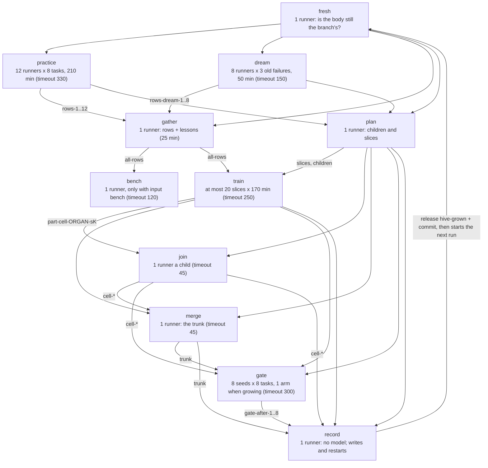

# Map of HiveMIND

Where everything is, who owns it, and how one generation flows. Read this first, then `docs/PLAN.md`.
Owners are from the "Who does what" table in `docs/AGENTS.md`: **B** runs the line and training, **C** commands
and holds the plan, **A** is stopped (its files are worked on by C's smaller agents). "None named" means no agent
holds the file; ask in the log of `docs/AGENTS.md` before changing it.
**Old** marks a folder or file from an earlier experiment: kept, not used by the line.
`tests/test_map.py` checks that every path named here exists and every job of the workflow is here.

## 1. The live line in one paragraph

`.github/workflows/grow.yml` ("The hive teaches its own members") is the line. Each run is one generation: the
body's cells practise fresh tasks and go back to old failures, the checked rows are gathered with the lessons,
every grown cell gets a child trained on slices of the rows, the slices are joined, the newest cells are averaged
into the trunk, the grown body sits a pulse exam, and the record job keeps everything and starts the next run.
Each step runs one subcommand of `training/grow.py`, `training/lineage.py`, `training/merge.py`,
`training/lessons.py`, `training/exam.py` or `training/grow_record.py`.

## 2. Folder by folder

### Top level

| Path | What it is | Owner | Read / written by |
|---|---|---|---|
| `README.md` | What the hive is; top part is the body of cells, later parts the older team of roles | none named | read by people |
| `docs/` | Plans, logs, knowledge, the runs list, progress graphs (below) | see below | agents; the record job |
| `.github/workflows/` | The workflows (below) | grow.yml: B | GitHub Actions |
| `.github/actions/hive/action.yml` | Installs the hive on a runner (engine, ternary runtime, cells) | none named | practice, dream, gate jobs |
| `training/` | The line's code (grow, lessons, exam, merge) plus many old scripts (below) | B mostly | the workflow jobs |
| `team/` | The runtime a member works in (`team/solo.py`, `team/ternary.py`) and the older team of roles | mixed (below) | every job that runs a model |
| `cells/` | `cells/body.json` (the body) plus old tiny-cell work (below) | record job only | lineage, ternary, record |
| `scripts/` | Tools agents run by hand after a generation (below) | mixed | agents |
| `tests/` | `python -m pytest -q tests`, no network, no model | each test with its file's owner | everyone, before a merge |
| `colab/hive_gpu.ipynb` | The owner's GPU notebook: trains children when it is open | B (with `training/colab.py`) | the owner; train job via the release |
| `requirements.txt` | Python packages | none named | train, join, merge jobs; `setup.sh` |
| `setup.sh` | Install on your own device (Linux, macOS) | none named | people |
| `hive` | Launcher: `./hive` runs `team/cli.py` | none named | people |
| `CLAUDE.md` | How every session works here: the goal's bars, the role, the cycle, the rules (loaded first by every session) | the loop holder | everyone |
| `NEXT_SESSION.md` | The one current handoff: what runs now, what is open, what is done and must not be redone | the loop holder | the loop holder |
| `docs/START_PROMPT.md` | The prompts to start a session: the loop holder, or a worker beside the others | the loop holder | the owner |
| `scripts/cycle.py` | Start of every cycle: the bars, the last generations as a table and text graph, stale graphs, next piece, who holds the loop | the loop holder | everyone |
| `FOR_MUSE.md` | Advice page of 2026-11-13 for another project. **Old** | none named | nobody |
| `adapters/` | Weight edits of the older roles (browser, coder, writer...). **Old** | none named | `team/` roles, ask.yml |
| `adapters_gguf/` | The same edits as llama.cpp files. **Old** | none named | `team/` roles |
| `demo/` | One recorded run of the older team of roles. **Old** | none named | nobody |
| `memory/` | Long-term memory of a local hive; only `memory/README.md` is in git | the user's own | `team/memory.py` |

### docs/

| Path | What it is | Owner | Written by |
|---|---|---|---|
| `docs/PLAN.md` | The plan, the numbers, the verdict table, the board of pieces | C | C; others ask in the log |
| `docs/AGENTS.md` | Who does what, how to join, rules, and the log (newest last) | everyone (log lines) | agents |
| `docs/history/` | Old handoffs (`NEXT_SESSION_*.md`, `HANDOFF_B_*.md`): history only | - | read once |
| `docs/MAP.md` | This page | none named | agents |
| `docs/KNOWLEDGE.md` | What is known, drawn from `docs/knowledge.json` | everyone | `scripts/knowledge.py` |
| `docs/knowledge.json` | Every finding and cause, as data | everyone | agents by hand |
| `docs/PROGRESS.md`, `docs/progress/` | Graphs of every generation | B (`training/progress.py`) | the record job |
| `docs/reads/` | The read of each generation (`docs/reads/latest.md` the newest): numbers, the chain by kind, hours, next piece | B (`training/reads.py`) | the record job |
| `docs/runs.csv` | One row per workflow run: number, id, kind, who started it, result | everyone | agents by hand |
| `docs/selfreliance.csv` | Right at the first try, hints per task, per generation | everyone | `scripts/selfreliance.py --add` |
| `docs/LOOP.md`, `docs/loop_log.csv` | The maintainer's loop and one row per cycle | everyone | agents |
| `docs/KERNELS.md` | Where time goes in the ternary runtime (measured 2026-11-14) | none named | reference |
| `docs/RESEARCH.md` | Published research on the open problems (2026-11-14) | none named | reference |
| `docs/history/` | Older handoffs. **Old** | none named | nobody |

### .github/workflows/

| Path | What it is | Live? |
|---|---|---|
| `.github/workflows/grow.yml` | The line: one generation a run, nightly at 01:17 UTC and self-restarting (section 3) | **live**, B's |
| `.github/workflows/talk.yml` | Answers the owner's issues with the body (`team/talk.py`) | live |
| `.github/workflows/ask.yml` | "Ask the hive": one task by hand (`python -m team`) | live, by hand |
| `.github/workflows/exam.yml` | Daily exam of the older team of roles; no schedule since 2026-11-15 | **Old** |
| `.github/workflows/hive.yml` | Grew bodies from random numbers (release "hive-state"); no schedule since 2026-11-15 | **Old** |
| `.github/workflows/practice.yml` | Practice with a library; no schedule (did worse than nothing learned) | **Old** |

### training/ (the line's code first)

| Path | What it does | Owner | Used by |
|---|---|---|---|
| `training/grow.py` | `practice`, `dream`, `gather`, `train`, `speed`; `Study` (T1), kept-back lessons (T2) | B | practice, dream, gather, train, bench |
| `training/grow_record.py` | `fetch` cells from the release; `rows`, `failures` merging; `gate` writes the record | B (record job) | practice, dream, gather, gate, record |
| `training/lineage.py` | Who is in the body, who has children, which cells make the trunk | none named | practice, dream, plan, merge |
| `training/lessons.py` | Hand-written right programs for kinds the body fails | B (T4: C) | gather |
| `training/merge.py` | `join` slices into a child; `trunk` averages cells | B | join, merge |
| `training/exam.py` | Makes, sits and checks exams; the gate's pulse | B | gate; practice via `training/grow.py` |
| `training/exam_hard.py` | The hard kinds; `HELD_OUT` (never taught) | none named (K1 open) | exam, lessons |
| `training/raw.py` | Raw text and voted answers mixed into training | B | train |
| `training/colab.py` | Order a child from the owner's notebook through the release (waiting for it up to HIVE_COLAB_WAIT), and mark the cell it grew | B | train |
| `training/progress.py` | Draws `docs/PROGRESS.md` and `docs/progress/` | B | record |
| `training/reads.py` | The run's facts (job hours, lost slices, slice records) and the read of a generation, `docs/reads/` | B | record; `scripts/read_generation.py` |
| `training/ternary_base.py`, `training/hive_bench.py` | Helpers imported by grow and exam | none named | grow, exam |
| `training/data/rows_g11_recovered.jsonl` | Recovered rows; gather adds every `training/data/rows_*.jsonl` | none named | gather |
| `training/reports/generations.jsonl` | One line per generation (and per trial): the record | record job only | read_generation, progress, lessons |
| `training/exam_record.py` | Adds a line to `training/reports/exams.jsonl` | none named | exam.yml (**Old**) |
| `training/hive_state.py`, `training/body.py`, `training/scratch.py` | Bodies grown from random numbers | none named | hive.yml (**Old**) |
| `training/cells*.py`, `training/cells_after.sh` and the like | Tiny cells, one per skill, of the older team. **Old** | none named | nobody in the line |
| `training/build_*.py`, `training/eval_*.py`, `training/train_lora.py`, `training/*_bench.py` | Role data, evals, role training. **Old** | none named | nobody in the line |
| `training/data/` (all but `rows_*`), `training/evals/` | Data and held-out evals of the roles. **Old** | none named | old scripts |
| `training/experiments/` | One-off speed and recipe trials. **Old** | none named | nobody |
| `training/reports/` (all but generations.jsonl) | Results of earlier experiments and exams. **Old** | none named | read for history |
| `training/llama_cpp_convert/` | A copied converter; the line uses the ternary runtime's own. **Old** | none named | old cell scripts |
| `training/tools/` | One dev helper | none named | by hand |

### team/

| Path | What it does | Owner | Used by |
|---|---|---|---|
| `team/solo.py` | A member does a whole task by writing and running programs; two must agree; the hints | A (C's agents now) | practice, dream, gate, talk |
| `team/tools/sandbox.py` | Runs members' programs safely | A (C's agents now) | `team/solo.py` |
| `team/ternary.py` | The ternary runtime: builds it, serves the DNA and cells, seats members | B | every model job |
| `team/talk.py` | Talk: answer at once or hand the work to the body | B | talk.yml |
| `team/config.py`, `team/llm.py`, `team/engram.py`, `team/memory.py`, `team/parts.py`, `team/health.py`, `team/stop.py` | Support imported by the line's code | none named | grow, exam, solo |
| `team/__main__.py`, `team/cli.py` | `python -m team` and `./hive` entry points | none named | ask.yml, people |
| `team/hive.py`, `team/board.py`, `team/specialists/`, `team/school.py`, `team/recruit.py`, `team/evolve.py`, `team/life.py`, `team/cells/`, `team/evolved/` and the rest | The older team of roles. **Old** (still reached by ask.yml and `./hive`) | none named | ask.yml, people |

### cells/

| Path | What it is | Written by |
|---|---|---|
| `cells/body.json` | The body: DNA, cells, trunk, parents, practice levels | the record job only |
| cells/strengths.json (not in git now) | Who is right on which kind, by organ; written only for a body that does not multiply, so absent while the body multiplies | the record job |
| `cells/adapters/`, `cells/variants/`, `cells/scratch/`, `cells/registry.json`, `cells/school.json`, `cells/spawned.json`, `cells/recruits.json`, `cells/wins.json`, `cells/LIFE.md` | Tiny cells and bodies of the older team. **Old** | old scripts |

The grown cells themselves are not in git: they live in the release `hive-grown` and are fetched onto a runner
into cells/members/ by `training/grow_record.py fetch`.

### scripts/

| Path | What it does | Owner |
|---|---|---|
| `scripts/read_generation.py` | Reads a run's artifacts: hard and easy by kind, losses, lessons, kept back | A (C's agents now) |
| `scripts/selfreliance.py` | Right at the first try and hints; adds a row to `docs/selfreliance.csv` | none named |
| `scripts/knowledge.py` | Draws `docs/KNOWLEDGE.md` from `docs/knowledge.json` | none named |
| `scripts/agents_log.py` | The board and the log from every branch | none named |
| `scripts/cloud_setup.sh`, `scripts/resume.sh` | Set up a cloud machine; resume work there | none named |

## 3. The workflow, job by job

Jobs and their `needs:` exactly as in `.github/workflows/grow.yml`. Boxes say runners x minutes (work time, then
the job's timeout). Edge labels are the artifacts passed.

The last edge is not a `needs:`: the record job runs gh workflow run grow.yml on `main`. The `needs:` lists:
practice and dream need fresh; gather and plan need fresh, practice, dream; bench needs gather; train needs gather,
plan; join needs plan, train; merge needs plan, train, join; gate needs plan, train, join, merge; record needs plan,
train, join, merge, gate. The record also downloads `rows-*` (practice.json, for levels) and `all-rows`.

| Job | What it does | Artifacts out |
|---|---|---|
| fresh | Ends the run if `cells/body.json` moved on the branch since it was queued; a nightly start ends if a run is under way | none |
| practice | `training/grow.py practice`, seeds 10000000 + run x 100 + runner, 600 s a task | rows-N (rows, failures, practice.json), practice-work-N |
| dream | `training/grow.py dream` on old failures from the release, 2 tries | rows-dream-N, dream-work-N |
| gather | Release rows + this run's rows + lessons (`training/lessons.py`), each row once | all-rows (rows.jsonl, failures.jsonl), lessons (the lessons' line, by kind) |
| bench | Times one training row each way; nothing grown | none |
| plan | `training/lineage.py plan`: children; splits them into at most 20 slices | job outputs children, grow, slices |
| train | `training/grow.py train` on one slice, from parent and trunk in the release; Colab may grow a child whole | part-VARIANT-ORGAN-sK |
| join | `training/merge.py join`: a child's slices into one cell | cell-ORGAN (versus-ORGAN in a versus trial) |
| merge | `training/merge.py trunk`: newest cell of every line averaged | trunk |
| gate | `training/exam.py sit --level mixed --tasks 8`, seeds 20000000 + (gate_seeds or run) x 10 + seed | gate-ARM-SEED, gate-work-ARM-SEED |
| record | `training/reads.py facts` (the run's jobs from the API); `training/grow_record.py gate`; uploads to release `hive-grown`; writes the read (`docs/reads/`), redraws progress and `docs/KNOWLEDGE.md`; commits; starts the next run | release assets, a commit |

Trials (input trial, versus or cells_from_run) sit three arms (dna, before, after; plus versus), so the gate is
24 or 32 jobs. Work artifacts (`*-work-*`) are kept 14 days, the rest 30.

## 4. Inputs and repository variables of grow.yml

### Inputs (Run workflow, or the record job's restart)

The restart passes only practice_level, dna, seating, dreams, pairs; every other input goes back to its default.

| Input | Default | Effect |
|---|---|---|
| shards | [1..12] | Practice runners, as a JSON list |
| tasks | 8 | Practice tasks on each runner |
| who | empty | Who practises and dreams; empty: the body's cells (`training/lineage.py members`) |
| organs | empty | Empty: the body multiplies. A list: one cell per organ, the old way (trials always) |
| epochs | 2 | Most passes over the rows in train |
| dna | t80 | The DNA: t17, t40 or t80; t40/t80 train with --int8-base |
| ternary | 0 | 1: the cells' own edits ternary too |
| foresee | empty | 1: also train to say what a program prints |
| dreams | empty (3) | Old failures each of the 8 dream runners corrects; 0: no dream job |
| practice_level | empty (ladder) | ladder, mixed or edge |
| fresh_rows | empty | 1: train only on this run's rows, not the release's |
| loop | empty | 0: this run does not start the next one |
| seating | empty | strength: seat tasks by cells/strengths.json (sets HIVE_SEATING) |
| versus | empty | Training flags for a second kind of cell on the same rows; always a trial |
| pairs | empty | 1: also learn from right beside wrong programs |
| trial | empty | 1: recorded and kept, the body is not changed; never restarts the line |
| gate_seeds | empty (run number) | Fixes the gate's seeds, so two runs sit the same exams |
| slow | empty | 1: train every layer and recompute (2.3 times slower); also stops the Colab offer |
| bench | empty | 1: nothing grown; the bench job times one row |
| cells_from_run | empty | A run id: nothing practised or trained; that run's slices are joined and sat |
| skip_practice | empty | 1: no practice or dream |
| rows_from_run | empty | A run id: also take its rows-* |

### Repository variables (Settings, Secrets and variables, Actions, Variables)

| Variable | Default | Read in | Effect |
|---|---|---|---|
| HIVE_LOOP | unset | record | `stop`: the record job does not start the next generation |
| HIVE_LESSONS | 12 (0-99) | gather | Lessons a kind (`training/lessons.py --per-kind`) |
| HIVE_SHARDS | 3 (1-8) | plan | Slices a child, cut so all train jobs fit in 20 |
| HIVE_READ | 40 | train | Raw text rows (`training/raw.py`); 0: none |
| HIVE_JUDGED | 10 | train | Voted best-and-worst answer rows; 0: none |
| HIVE_COLAB_CHILDREN | 1 (0-9) | train | Children offered to the Colab notebook, each 70/K minutes (15 to 60); 0: none |
| HIVE_COLAB_WAIT | 15 (0-99) | train | Minutes the child offered to Colab waits for the notebook (slice 0 orders, the others stand aside on the order); none when it was not seen in 12 hours |

HIVE_KEEP_BACK is **not** a repository variable: it is an environment variable read by `training/grow.py`
(lessons of each kind kept back from training and only measured, default 2). grow.yml does not set it, so the
line keeps back 2.

### Environment set by grow.yml

| Name | Value | Effect |
|---|---|---|
| AGENT_TEAM_SOLO | 2 | Two members do each task (`team/solo.py`) |
| AGENT_TEAM_SOLO_ALONE | 1 | Members alone count, as a measurement |
| HIVE_LIGHT | 1 | The runner installs only the ternary runtime (`.github/actions/hive/action.yml`) |
| GEN, DNA | g + run number; input dna | Names of the generation and the DNA |
| HIVE_SEATING | strength or empty | From input seating |
| HIVE_ROTATE | runner number | practice, dream: a different cell beside the trunk on each runner |
| HIVE_TASK_SECONDS | 600 | practice, dream: most seconds a task; the gate keeps its own cap |

## 5. Where each generation's data lives

| Data | Where | Written by |
|---|---|---|
| The body (DNA, cells, trunk, parents, levels) | `cells/body.json` on the branch | record job (`training/grow_record.py gate`); not by a trial |
| One line per generation and trial: arms, hard/easy, practice, why | `training/reports/generations.jsonl` | record job |
| Progress graphs | `docs/PROGRESS.md`, `docs/progress/` | record job (`training/progress.py`) |
| Who is strong on what | cells/strengths.json (absent now) | record job, only for a body that does not multiply |
| Cells (gguf, json, safetensors), trunk, all rows, all failures | release hive-grown (assets DNA.GENorgan.*, DNA.GENtrunk.*, rows.jsonl, failures.jsonl) | record job; added to, never replaced |
| Colab orders and answers | release hive-grown (colab-* assets) | train job and the notebook (`training/colab.py`) |
| Members' work, server logs, exam results | run artifacts practice-work-*, dream-work-*, gate-work-*, gate-* (14 / 30 days) | practice, dream, gate jobs |
| Every run, who started it, result | `docs/runs.csv` | agents by hand |
| First-try share and hints | `docs/selfreliance.csv` | agents, `scripts/selfreliance.py --add` |
| The verdict after a generation | `docs/reads/latest.md` (and `docs/reads/` by generation), with its next piece | record job (`training/reads.py`) |
| Findings and causes | `docs/knowledge.json` -> `docs/KNOWLEDGE.md` | agents, `scripts/knowledge.py` |

Only the record job writes `cells/body.json` and `training/reports/generations.jsonl` (rule in `docs/AGENTS.md`).
The jobs that run models have no token that can write anywhere; the train job may write the release only for Colab.
