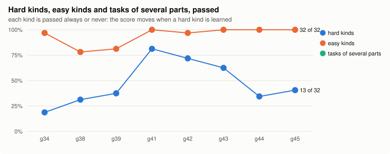

# HiveMIND: progress toward the goal

**The goal:** a body of ternary nets that does what it is asked (questions, conversation, tasks), and gets better at it by itself, generation after generation.

This page is drawn by the hive itself at the end of every generation (`training/progress.py`, run by the workflow's record step). Hover a point in a graph for its numbers.

**Now:** generation g28 of the 8B body passed 18 of 32 exam tasks (56%). The best so far on this DNA: g28, 18 of 32 (56%).

## Where it practises most next

Practice draws each kind of task by how close the body is to passing it half the time: a kind always passed is learned, one never passed has no right program to learn from yet. Most drawn next:

- a simulation followed step by step
- a thing to know
- the weekday of a date
- a unit conversion
- a fact read from a source
- a module of two functions, with hidden tests

## How hard its lessons are now

Each record raises a kind's level when the body passes it 7 times in 10, and lowers it at 3 in 20: compound 2, h_join 0, h_log 0, h_search 0, m_percent 0, m_table 0.
