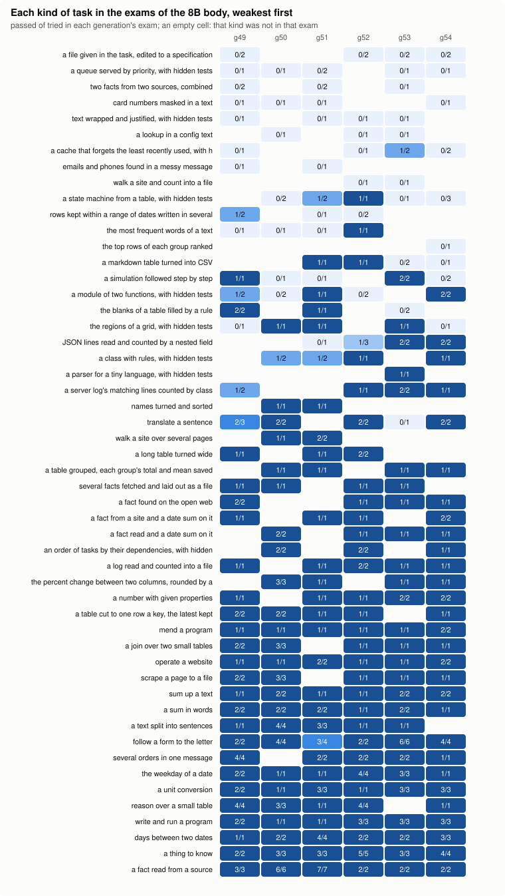

# HiveMIND: progress toward the goal

**The goal:** a body of ternary nets that does what it is asked (questions, conversation, tasks), and gets better at it by itself, generation after generation.

This page is drawn by the hive itself at the end of every generation (`training/progress.py`, run by the workflow's record step). Hover a point in a graph for its numbers.

**Now:** generation g27 of the 8B body passed 15 of 32 exam tasks (47%). The best so far on this DNA: g27, 15 of 32 (47%).

## Where it practises most next

Practice draws each kind of task by how close the body is to passing it half the time: a kind always passed is learned, one never passed has no right program to learn from yet. Most drawn next:

- the weekday of a date
- a unit conversion
- a fact read from a source
- a thing to know
- scrape a page to a file
- several facts fetched and laid out as a file
