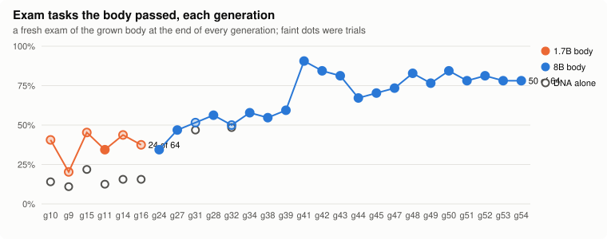
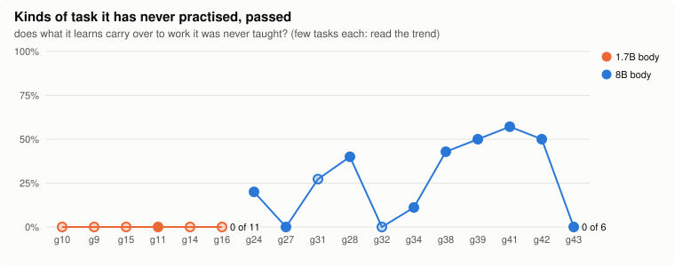
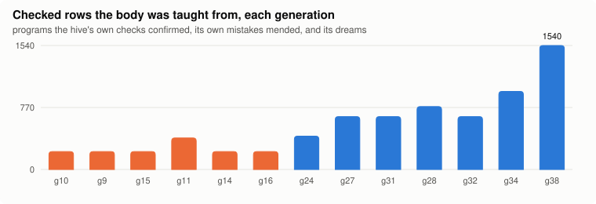
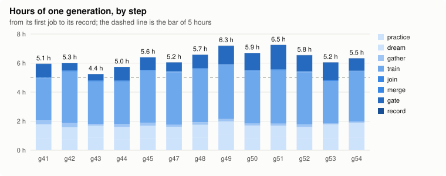

# HiveMIND: progress toward the goal

**The goal:** a body of ternary nets that does what it is asked (questions, conversation, tasks), and gets better at it by itself, generation after generation.

This page is drawn by the hive itself at the end of every generation (`training/progress.py`, run by the workflow's record step). Hover a point in a graph for its numbers.

**Now:** generation g60 of the 8B body passed 48 of 64 exam tasks (75%). The best so far on this DNA: g41, 58 of 64 (91%).

**Talk:** generation g60 sat the talk exam (seed 30000060): 8.2 of 10 (33 of 40 messages right: route 8 of 10, fact 9 of 10, earlier 9 of 10, time 7 of 10). The bar: 8 of 10.

Its read, with the next piece: [reads/latest.md](reads/latest.md).

Generations that stand on less (marked red in the split graph): g41: 1 of 20 train slices lost; g42: 2 of 20 train slices lost; g44: 2 of 20 train slices lost; g45: 1 of 20 train slices lost; g47: 2 of 20 train slices lost; g48: 1 of 20 train slices lost; g49: 2 of 20 train slices lost; g50: 3 of 20 train slices lost; g51: 2 of 20 train slices lost; g52: 3 of 20 train slices lost; g53: 3 of 20 train slices lost; g54: 3 of 20 train slices lost; g56: 2 of 20 train slices lost; g57: 4 of 20 train slices lost; g59: 2 of 20 train slices lost; g60: 4 of 20 train slices lost.

## Where it practises most next

Practice draws each kind of task by how close the body is to passing it half the time: a kind always passed is learned, one never passed has no right program to learn from yet. Most drawn next:

- the regions of a grid, with hidden tests
- a server log's matching lines counted by class
- JSON lines read and counted by a nested field
- several tasks in one
- an order of tasks by their dependencies, with hidden tests
- a long table turned wide

## How hard its lessons are now

Each record raises a kind's level when the body passes it 7 times in 10, and lowers it at 3 in 20: compound 3, h_join 1, h_log 1, h_search 1, m_percent 1, m_table 1.
