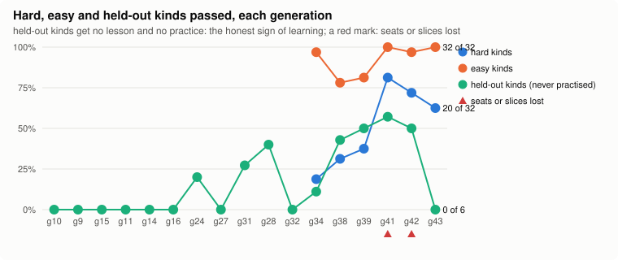

# HiveMIND: progress toward the goal

**The goal:** a body of ternary nets that does what it is asked (questions, conversation, tasks), and gets better at it by itself, generation after generation.

This page is drawn by the hive itself at the end of every generation (`training/progress.py`, run by the workflow's record step). Hover a point in a graph for its numbers.

**Now:** generation g39 of the 8B body passed 38 of 64 exam tasks (59%). The best so far on this DNA: g39, 38 of 64 (59%).

Its read, with the next piece: [reads/latest.md](reads/latest.md).

No record says a generation's hours yet: the record job is to write `minutes_by_step` (minutes of practice, dream, gather, plan, train, join, merge, gate and record, each from the first job of the step starting to its last ending) and `hours` (the run's first job starting to the record), and `dead_seats` and `lost_slices` ([lost, of]).

## Where it practises most next

Practice draws each kind of task by how close the body is to passing it half the time: a kind always passed is learned, one never passed has no right program to learn from yet. Most drawn next:

- scrape a page to a file
- a module of two functions, with hidden tests
- a fact from a site and a date sum on it
- several facts fetched and laid out as a file
- a log read and counted into a file
- translate a sentence

## How hard its lessons are now

Each record raises a kind's level when the body passes it 7 times in 10, and lowers it at 3 in 20: compound 2, h_join 0, h_log 0, h_search 0, m_percent 0, m_table 1.
