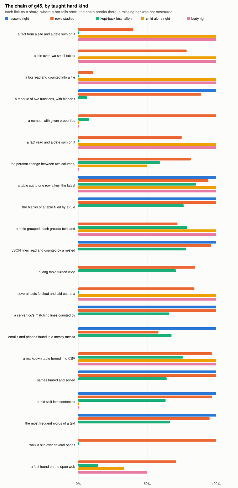

# The read of g43

Run [44188515917](https://github.com/Arnav123-s/HiveMIND/actions/runs/44188515917) (this read was written again by hand from the record: the record job could not write it, see training/reads.py; hours by step are in generations.jsonl), recorded 2026-11-18 02:41: the body was **kept**. the body grows: after 52 of 64 (easy 32 of 32, hard 20 of 32), before 54 of 64 (easy 32 of 32, hard 22 of 32) on 8 seeds

Written by the record job (`training/reads.py`), with nobody's hand. The rules are those of `docs/DECISIONS.md`.

## The numbers

| What is measured | g43 | g42 (last record) | the body before (same seeds) |
|---|---|---|---|
| Easy kinds passed | 32 of 32 | 31 of 32 | 32 of 32 |
| Hard kinds that have lessons | 20 of 26 | 18 of 22 | 21 of 26 |
| Hard kinds never practised (held out) | 0 of 6 | 5 of 10 | 1 of 6 |
| Right at the first try (practice) | 0.53 (51 of 96) | 0.58 | - |
| Hours for one generation | 4.4 | 5.3 | - |
| Generations recorded with nobody's hand | 2 | 1 | - |

## The chain, by taught hard kind

lessons right by their own check -> rows that fit in training -> loss falls on lessons kept back -> the child alone writes it at the exam -> the body (two agree) passes it.

| kind | lessons right of made | rows left out | kept-back loss before -> after | gap to untaught (points) | child alone right | parent alone right | body right | body before |
|---|---|---|---|---|---|---|---|---|
| a fact from a site and a date sum on it | none made | not measured | not measured | not measured | - | - | 2 of 2 | 2 of 2 |
| a join over two small tables | none made | not measured | not measured | not measured | - | - | 5 of 5 | 5 of 5 |
| a log read and counted into a file | none made | not measured | not measured | not measured | - | - | 1 of 1 | 0 of 1 |
| a module of two functions, with hidden tests | none made | not measured | not measured | not measured | - | - | 2 of 7 | 3 of 7 |
| a number with given properties | none made | not measured | not measured | not measured | - | - | 1 of 1 | 1 of 1 |
| a fact read and a date sum on it | none made | not measured | not measured | not measured | - | - | 1 of 2 | 2 of 2 |
| the percent change between two columns, rounded by a rule | none made | not measured | not measured | not measured | - | - | - | - |
| a table cut to one row a key, the latest kept | none made | not measured | not measured | not measured | - | - | - | - |
| the blanks of a table filled by a rule | none made | not measured | not measured | not measured | - | - | - | - |
| a table grouped, each group's total and mean saved | none made | not measured | not measured | not measured | - | - | - | - |
| JSON lines read and counted by a nested field | none made | not measured | not measured | not measured | - | - | - | - |
| a long table turned wide | none made | not measured | not measured | not measured | - | - | - | - |
| several facts fetched and laid out as a file | none made | not measured | not measured | not measured | - | - | 2 of 2 | 2 of 2 |
| a server log's matching lines counted by class | none made | not measured | not measured | not measured | - | - | - | - |
| emails and phones found in a messy message | none made | not measured | not measured | not measured | - | - | - | - |
| a markdown table turned into CSV | none made | not measured | not measured | not measured | - | - | - | - |
| names turned and sorted | none made | not measured | not measured | not measured | - | - | - | - |
| a text split into sentences | none made | not measured | not measured | not measured | - | - | - | - |
| the most frequent words of a text | none made | not measured | not measured | not measured | - | - | - | - |
| walk a site over several pages | none made | not measured | not measured | not measured | - | - | 4 of 4 | 4 of 4 |
| a fact found on the open web | none made | not measured | not measured | not measured | - | - | 2 of 2 | 2 of 2 |

- lessons: no lessons line from gather was found
- rows left out: no train slice's record was read
- kept-back loss: no slice's record has lessons kept back (training/grow.py kept_back, from generation 39)
- child and parent alone: the pulse kept no member's own answer (training/exam.each_member)

## Hours

| step | minutes |
|---|---|
| practice | 51 |
| dream | 51 |
| gather | 6 |
| plan | 0 |
| train | 176 |
| join | 2 |
| merge | 2 |
| gate | 26 |
| record | 1 |

From the first job to the last: **4.4 hours** (the bar is 5). Each step runs from its first job's start to its last job's end; practice and dream run side by side.

Train slices lost: 0 of 20. Pulse seats whose server died: 0.

Colab: not measured (no train slice was read)

## Next piece

next piece: K1: then K2 (wider) and M1 (the talk exam) (rule 6: taught hard kinds 12 of 23, two generations running, for 21 of 21 taught hard kinds: a fact from a site and a date sum on it, a join over two small tables, a log read and counted into a file, a module of two functions, with hidden tests, a number with given properties, a fact read and a date sum on it, the percent change between two columns, rounded by a rule, a table cut to one row a key, the latest kept, the blanks of a table filled by a rule, a table grouped, each group's total and mean saved, JSON lines read and counted by a nested field, a long table turned wide, several facts fetched and laid out as a file, a server log's matching lines counted by class, emails and phones found in a messy message, a markdown table turned into CSV, names turned and sorted, a text split into sentences, the most frequent words of a text, walk a site over several pages, a fact found on the open web)

| # | the chain shows | holds for |
|---|---|---|
| 1 | lessons right under 8 of 12 | 0 |
| 2 | more than 1 row in 5 of the kind left out | 0 |
| 3 | kept-back gap under 15 points | 0 |
| 4 | gap 15 or more, the child alone right more often than its parent, the body not | 0 |
| 5 | gap 15 or more, the child alone not right | 0 |
| 6 | taught hard kinds 12 of 23, two generations running | 21 |

Not measured this generation, so no rule could hold on it: lessons, rows left out, kept-back gap, child alone.
