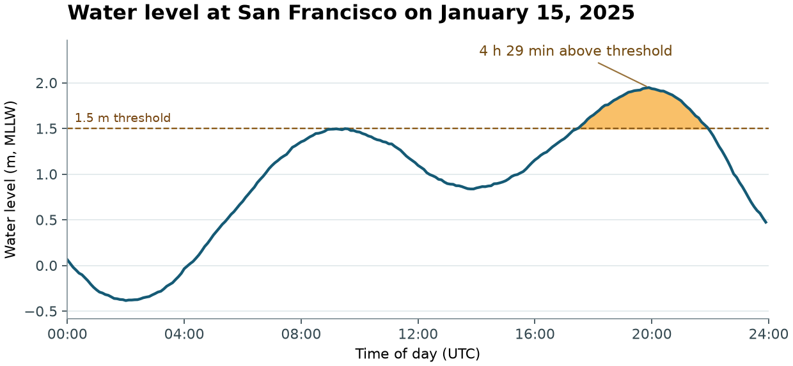

# Recovering a useful calculation from a failed sensor program

A generation-47 data cell wrote a program to measure how long a linearly changing signal spent above a threshold and how many times it crossed upward. It already handled upward crossings. Asking the cell to revise its code after three concrete failures had left its answer unchanged. We kept the cell's function and used a small symbolic search to learn when to call it forwards, call it with the readings reversed, or use the whole segment length. The selected rule passed all 228 fresh sensor cases. [Original task, replies and grading](https://github.com/Arnav123-s/HiveMIND/blob/a70eb72a286020e5dceafb451d6d2051756cd44c/training/reports/whole-hive-g47/observations.json)

| Rule fitted before evaluation | Sensor paths and edge cases | Cable routes in a moving clearance envelope |
|---|---:|---:|
| Original cell program | 105/228 | 97/266 |
| Nine published grid observations | 185/228 | 167/266 |
| Grid plus the tenth published observation | 194/228 | 163/266 |
| Ten published observations plus one inferred reversal | **228/228** | **266/266** |
| Same search with shuffled labels | 49/228 | 62/266 |
| Remove the reversed parent from the possible predictions | 204/228 | 148/266 |

**How the repair worked.** The search saw nine public two-reading observations plus a separately published example in which both readings were above threshold. Every off-diagonal grid pair had a partner with the endpoints reversed. Their durations above threshold always agreed. Applying that symmetry to the tenth observation supplied one new label, for a decreasing pair above threshold. The experiment tests that symmetry on the duration alone. Reversing a segment can change its upward crossing count.

We supplied the segment decomposition, the original count function, eligible-segment rules, and a search space. Its five possible predictions were the original cell on either endpoint order, zero, half, or the full segment length. It could compare any pair drawn from the start reading, end reading and threshold using three comparison operators. The search minimized errors on the available examples, then tree size, to depth three. It scored 915 leaf choices and 497 splits across cached subproblems. The shuffled-label control did exactly the same work. Every fitted arm obtained zero errors on its own search observations. Only the full repair passed every fresh case.

The learned tree has two decisions. If the first reading is below threshold it calls the original program. Otherwise, if the second reading is at or below threshold, it calls the program with the endpoints reversed. For all remaining segments it returns the full duration. The rule can be saved and reused independently of the search.

A later comparison gave the released code cell the original function and the same ten public observations, with freedom to write any repair. In one greedy attempt, it returned the original function byte for byte. It again passed 105/228. The reply, input, model hashes and per-case grading method are available in the [free-form repair experiment](free-proposal/README.md).

**What transferred.** A separate job measured cable-route length with a height above a varying lower limit and at or below a varying upper limit. We wrote an adapter that transforms the height relative to each bound, calls the saved worker twice, and takes the difference. The same adapter with the original cell got 97/266. The repaired worker got 266/266 with no new examples or changes to its tree. Both jobs share piecewise-linear geometry. The result shows reuse within that family. Choosing that decomposition, the idea to reverse a call, and the second job's adapter all came from the experiment designers. This experiment used CPU search and the frozen output of a real model, with zero new model calls or weight updates. Automatic discovery of operators for unrelated tasks remains open.

**How we checked it.** An independent contributor wrote and sanity-checked a grader before the candidate trees were frozen. It uses exact rational interval partitioning and midpoint classification, with missing measurements, gaps, equal endpoints, varying bounds and fractional coordinates. The repair author froze the arms before receiving any grader outputs. The score command refits each arm from the same public examples, then grades it. The refitted trees matched the saved alternatives and a second run reproduced the results byte for byte. A separate retrospective rerun of the prior review's three suites gave the original worker 16/40, 41/96 and 190/256. The selected repair achieved 40/40, 96/96 and 256/256. These last 392 cases belong to the prior review and are counted separately.

**A measured day in San Francisco.** NOAA's station 9414290 recorded 240 verified six-minute water levels on January 15, 2025 UTC. The original program counted only **3 minutes** above 1.5 metres over mean lower low water. The frozen repair calculated **268.9091 minutes** (about 4 hours 29 minutes) and **one upward crossing**. An independent rational calculation on the original decimal measurements returned the same duration and count. Both calculations assume linear change between the readings. The record covers 00:00–23:54 UTC, with 239 complete six-minute intervals and no extrapolation. All rows were flagged verified and had zero quality flags. The archived CSV contains UTC timestamps and heights in metres. [NOAA measurements](https://api.tidesandcurrents.noaa.gov/api/prod/datagetter?begin_date=20250115&end_date=20250115&station=9414290&product=water_level&datum=MLLW&units=metric&time_zone=gmt&format=json&application=HiveMIND) · [Runnable tide data](san-francisco-tide.csv)



From the repository root, fit the rule, evaluate the arms, or apply the already saved rule to a task. All three commands use the Python standard library.

```sh
python -m training.experiments.checked_repair fit
python -m training.experiments.checked_repair score
./hive exposure training/reports/checked-repair/san-francisco-tide.csv --threshold 1.5 --max-gap 6
echo '{"points":[[0,7],[4,1]],"ceiling":3,"max_gap":4}' > /tmp/hive-exposure.json
python -m training.experiments.checked_repair apply training/reports/checked-repair/rule.json /tmp/hive-exposure.json
```

For a CSV with your own readings, replace the filename following `./hive exposure`. The default columns are `timestamp,value`. Specify different names with `--time-column` and `--value-column`. Use ISO 8601 dates and times or numeric timestamps. The default unit for numeric time, duration and maximum gap is minutes. Set `--unit seconds` or `--unit hours` as needed. Blank, `NA`, `N/A`, `null` or `none` readings break the series.

For a JSON measurement job, substitute its path for the last argument. Use strictly increasing times in minutes, a reading or `null` at each time, a threshold in the readings' units, and a maximum allowed gap in minutes. The final command's example returns approximately 2.667 minutes above threshold and zero upward crossings. [Saved rule](rule.json) · [Frozen alternatives](frozen-arms.json) · [All fresh scores](results.json) · [Search and worker](../../experiments/checked_repair.py) · [Independent grader](../../experiments/checked_repair_grade.py) · [Archived parent function](../../experiments/checked_repair_parent.py)

| Frozen artifact | SHA-256 |
|---|---|
| Search script before held-out scoring | `5371947a697be465eff4b1299c56b7f15beae362d7a1e5b883a208f778e8aa69` |
| Fitted arms before held-out scoring | `1e685f3231759f0f9bcd08cee789e4413a08f70687d62b81b7a83e451ed0d4d6` |
| Independent grading script | `d35e7c75fc8b9aaed9f28d1c4f84bdf41ca67fa875a54d4ed0788a6a51b6e38c` |
