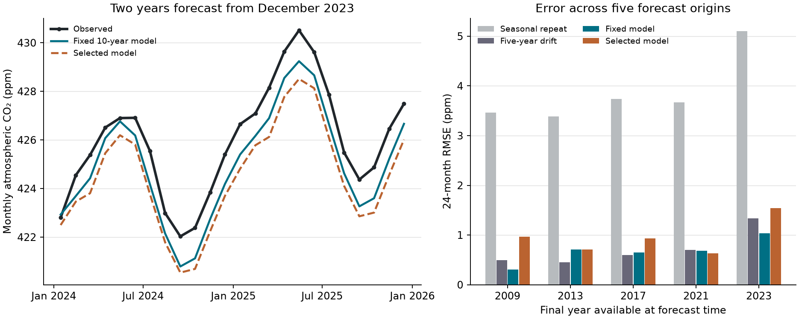

# Can a CPU hive finish new scientific and programming work?

I gave the hive new contracts, public examples, execution, and a place to keep useful programs across tasks. I judged it by what its frozen programs predicted, scheduled or wrote to disk. The strongest evidence of growth came from reusing a working part of a failed geology program and learning missing rules from observations. One CPU machine ran the trials. The language models were pretrained. The growth measured here took place in executable programs, reusable equation structures, and coefficients fitted to new instruments.

The hive completed several useful, bounded jobs, including harder cases where its original models failed. The field dispatcher tested available workers on public data, froze the selected program, and then ran it on new inputs. It was given the task's public contract and the set of eligible workers. A separate new observatory order used the general work-order entry point.

| Work finished | Worker selected using public evidence | Exam | Confirmation |
| --- | --- | ---: | ---: |
| Weighted observation scheduler | Fitted algorithm family | 73/73 | 49/49 |
| Time-dependent trip planner | Fitted algorithm family | 73/73 | 49/49 |
| Revised geology orders | Repaired model-written phases | 72/72 | 48/48 |
| Historical CO₂ forecasts | Rolling forecast selection | 5/5 | 4/4 |
| Unfamiliar thermal instruments | Trajectory-based model selection | 17/18 | 11/12 |

The two algorithm workers drew on supplied algorithm families. The geology worker grew through fragment recovery and small checked edits to model-written code. The scientific workers selected measurements or fitted models from supplied numerical methods. The separate observatory assembly passed all 48 two-file audits and processed 39,965 records in its scaling check. [Seven runnable workers and checksums](fieldwork/programs.zip) · [All attempts and scores](fieldwork/evidence.json.gz)

## A failed worker became part of a working one

The geology order arrives in two parts. Initially, the worker must resolve unordered sample revisions, ignore duplicates, quarantine conflicting tickets and write a snapshot. After a restart the user excludes a zone and sets a minimum group size. The worker must produce a CSV sorted by total mass and an audit that still counts every originally kept ticket.

The Qwen3-4B coding member's first whole program failed all 72 exam orders. Inside that program was a correct intake algorithm. A routine used public output keys to try returning the worker's existing variables at different statement boundaries. The first fragment that passed all nine public intake examples returned the sorted `kept` and `conflicts` lists after the sixth statement. The search introduced the return and output ordering. The model had written the revision handling, deduplication and conflict detection.

I supplied a second cell with a family of 768 group-and-report programs. Public evidence determined which columns held the group and mass, which comparison to use, how to sort the report and which count belonged in the audit. Two variants fit the nine public demonstrations. The cell found a snapshot with equal group masses and requested the observed report. The order of Alto and Bend resolved the tie. The combination completed **72/72** exam orders and **48/48** further orders. Each revision ran in a fresh interpreter using the persisted snapshot. The host reread and checked both files. This is a way for imperfect cells to contribute without a majority vote. [Recovery and phase generation](../../experiments/fieldwork/stages.py) · [Reporting school](../../experiments/fieldwork/report_school.py)

A second route required less human-provided algorithm structure. Describing the input paths to a reporting cell got all nine public audit JSON files right. Its CSV summed ticket revision numbers where the user wanted a count. That pair completed **1/72** exam orders. A generic search tried replacing sums of projected values with row counts. Keeping the edit that improved the public files gave **72/72** and **48/48** using the model's original reporting algorithm. I then tested two sets of 96 orders against an independent SQLite implementation. They included empty intakes, zero masses, varied labels, negative revisions and duplicate top records. The first worker completed **69/96** and **60/96**. A public demonstration with a comma in a zone name let a second generic edit replace raw comma joining with a CSV writer. The repaired pair completed **96/96** on each set. I supplied the allowable types of edit. The search selected which expression and output operation to change. Both extended arms were evaluated on the same two seeds. [Program edits and independent SQLite oracle](../../experiments/fieldwork/phase_repair.py)

The included CLI example uses this repaired pair on a different set of tickets. A user excludes Coast and requests at least two tickets per zone. The saved report has `Ridge,2,40`. The audit preserves five kept tickets and the quarantined ticket G3. Once the worker qualified, this new order needed zero model calls. The committed files include the intake snapshot, revised summary and audit. [Delivered files](fieldwork/example-outputs/geology) [Runnable work order](fieldwork/geology-order.json) · [Run it on a CPU](fieldwork/reproduce.md)

## Scientific work with consequences that can be checked

**Atmospheric CO₂.** The hive forecast each of the next 24 monthly Mauna Loa measurements from 20 past years. I evaluated five forecast origins with disjoint target periods, then four more. The ten-year linear trend with calendar-month offsets passed all five original horizons. So did a cell that chose its history length and polynomial degree using older rolling forecasts. Pooled RMSE on the first 120 forecast months was **0.714 ppm** for the fixed model and **1.007 ppm** for the selector. The selector had lower error on the three development periods. The ranking reversed across the five exam periods. The stronger drift baseline occasionally beat both. At the December 2023 origin the fitted ten-year trend was **2.47 ppm/year**, with the typical detrended peak in May. These are retrospective calculations from the October 2026 data vintage. The training windows overlap and revisions to historical measurements are possible.

I also held out January–September 2026, fitted both methods through December 2025, and obtained **0.299 ppm RMSE** for each. For the separate prospective forecast both methods selected the same ten-year model using measurements through September 2026. The frozen calendar-2027 forecasts include **434.684 ppm for May**. Future monthly observations will determine its accuracy. The files contain the training cutoff, projections, methods and previous observations. [2027 monthly forecast](fieldwork/co2-2027.csv) · [Forecast record](fieldwork/co2-forecast-record.json)

Credit for the measurements belongs to NOAA Global Monitoring Laboratory and the Mauna Loa CO₂ measurement program. NOAA describes temporary substitution of observations at Maunakea after the November 2022 eruption. The monthly product includes adjustments for observation timing and some interpolated months. The analysis uses its published monthly averages. [NOAA GML data and credits](https://gml.noaa.gov/ccgg/trends/data.html) · [Exact downloaded file with provenance](fieldwork/noaa-2026-10-09.csv)

**Unknown thermal instruments.** The numerical cell selected its own 48 heater settings by comparing how well 80 candidate drives distinguished possible terms. It then identified a sparse equation, validated the number of terms on earlier portions of its own readings, and predicted 54 new settings after a reset. I supplied the possible terms, the search and the experiment criterion. The cell chose measurements, variables, equation size and coefficients on each device.

| Method | 18 blinded instruments | 12 further instruments |
| --- | ---: | ---: |
| Fixed first-order response, same chosen drive | 0/18 | 3/12 |
| Learned equation, repeating heater pattern | 2/18 | 4/12 |
| Learned equation, chosen drive | 17/18 | 11/12 |

Each pass required normalized RMSE at most 0.10. The distinct devices include delay, asymmetric heating and interactions. The independent-number-of-terms choice sometimes allowed unstable rollout. In another study 24 training devices contributed 16 distinct qualified equation structures. Reusing these structures with coefficients fitted afresh raised performance from **71/72 to 72/72** across three new populations. A random bank with matching sizes plus fresh learning scored **71/72**. The gain is one instrument. [Active experiment and fitting](../../experiments/fieldwork/discovery.py) · [Growth and random-memory control](../../experiments/fieldwork/thermal_school.py)

**Recognizing the edge of an explanation.** A separate suite contained 30 linear devices, 30 devices with an unobserved persistent on/off state, and 30 with a freshly drawn unmeasured disturbance. A second 24-step experiment tested whether the first fit could predict what happened after the drive returned to zero. A linear-only worker correctly forecast all 30 linear devices and deferred the other 60. Allowing a candidate persistent state let the cell infer switch thresholds, deliver correct forecasts on all 30 latch devices and retain the 30 linear results. It withheld forecasts on all 30 externally disturbed devices. The proposed kind of hidden state and the second probe were supplied in the experiment. Discovery of a new family from scratch remains open. [Instrument study](../../experiments/fieldwork/unknown_instruments.py)

## Coding at a size where brute force stops working

The roster problem maximizes reward with cooldown intervals, an odd-count constraint and exact counting of tied optima modulo a prime. The ferry problem finds a time-dependent route with an optional one-use layover waiver and a tie preference. Tiny cases have independent exhaustive or time-expanded oracles. Large constructed cases have analytically known answers. The primary large instances contain **42,069 intervals** and **65,999 links across 22,001 stops**.

I supplied two algorithm families, weighted interval dynamic programming and a two-state shortest-path search. Nine small demonstrations identified the needed conventions in each family. The timetable worker called an earlier cell that had learned how to align a departure grid. In that earlier school, two rules survived 90 observed rows. The cell asked about an endpoint where one rule predicted no arrival and the other predicted 21. The observed 21 selected the inclusive rule. Both resulting field solvers passed **73/73** and then **49/49**. All the large cases ran inside the same CPU guest as the model-authored submissions. These scores establish successful specialization and execution of the supplied algorithms. [Algorithm families](../../experiments/fieldwork/algorithm_school.py) · [Earlier school](../../experiments/fieldwork/induction.py)

## A new observatory work order

A new brief asked for intervals where enough **distinct** radio instruments observed simultaneously. Records can repeat, cross a boundary or overlap within one instrument. Counting records gives a plausible wrong answer. The job requires two files, and timestamps can be trillions apart.

Qwen3.5-4B learned an interval-union function on an earlier exercise. It passed three public examples and 24 independent checks in one 358-token submission. Its first two full-work-order attempts exhausted 1,400 tokens each. Giving it the complete parent source also failed the public examples. When a different 4B writer was asked for the coverage stage, it copied the earlier interval-union task. Moving a callable description before the current assignment raised its best public score from **0/3 to 1/3**. Both views failed to qualify a full interval worker. The file-formatting cell independently wrote a correct renderer in 232 tokens, passing **32/32** new cases. Copying a parent's source can compete with following the current instruction.

I also compared two short attempts with one code-only attempt capped at the same combined 2,800 tokens. On 48 fresh hidden jobs the longer unaided program passed **0/48**. With the helper in context it used 871 tokens and passed **24/48**. Every correct answer had empty coverage. Removing the callable helper from the identical submitted program gave the same **24/48** and **0/24** positive cases. Both workers produced zero file sets and failed the 35,515-record stress test.

The successful combination used those two model-written functions and a supplied family of event sweeps. Without an interval-union member, none of eight eligible sweeps fit the public demonstrations. With that member, two of 32 sweeps survived. One extra measurement distinguished them. The selected program produced the correct intervals on **48/48** unseen audits and a **39,965-record** stress case. Linked to the learned renderer, it passed all 48 complete two-file checks, including all 26 with nonempty coverage, the stress case, and the four separate jobs whose files the grader reopened. This result depends on the supplied sweep family. The empty-library control measures the value of that helper within this search space. [Sweep and school](../../experiments/fieldwork/sweep_school.py) · [New runnable observatory order](fieldwork/observatory-order.json) · [Delivered files](fieldwork/example-outputs/observatory)

## What the language models accomplished directly

Each entry counts completely correct unseen cases. The two coding columns include one large case each. A dash indicates an unrun condition. All results in this table used the standard-library WebAssembly guest.

| Local writer and condition | Roster / 73 | Ferry / 73 | Geology / 72 | CO₂ / 5 | Thermal / 18 |
| --- | ---: | ---: | ---: | ---: | ---: |
| HiveMIND g41, first | 0 | 0 | 0 | 0 | 0 |
| Qwen2.5-Coder-3B, first | 0 | 0 | 0 | 0 | 0 |
| Qwen3-4B-2507, first | 29 | 38 | 0 | 0 | 0 |
| Qwen3-4B-2507, public repair | 29 | 46 | 0 | 0 | 0 |
| Qwen3-4B-2507, school and public repair | 0 | 46 | 0 | 0 | 0 |
| Qwen3.5-4B, first | 0 | 0 | 0 | 0 | 0 |
| Qwen2.5-Coder-7B, first | 0 | 46 | 0 | — | — |
| Qwen2.5-Coder-7B, school and reference notes on public failure | 5 | 46 | 0 | — | — |

The g41 and 3B members each qualified zero of six original school exercises. Qwen3-4B qualified an interval optimizer and a timetable alignment function. A separate finite search learned a version rule. On the field roster, handing the 4B member checked school code reduced its exam score. On the ferry, adding school code matched the public-retry result. For the two scientific tasks the bank had no eligible functions, so the grown condition reuses the identical public-retry selection. Recruiting a larger model, retrieving a verified helper and adding a feedback turn each have separate costs and outcomes.

The 7B coder used the repo's registered Q4_K_M model, a 4.68 GB file. It received an explicit decoded-input contract and a concise code request, with up to 1,500 generated tokens. Its second condition supplied textbook notes and earlier checked functions only when the first submission failed public checks. The other first submissions used the original prompt and a 1,400-token cap. These comparisons describe what each configuration delivered. Prompt and compute differences limit causal estimates of model size.

I also ran the frozen scientific submissions in a NumPy-capable local guest and tried small interface fixes. The 4B analyst's program estimated the ten-year CO₂ trend within **0.063 ppm/year** of the independent reference at all five exam dates. Its mean two-year forecast RMSE was **2.27 ppm**, and seasonal errors also cost it full-task credit. Across those frozen writers the scientific full-task scores remained zero. This points to a role for partial results such as a credible trend estimate, provided the next cell validates the entire requested analysis. [Runtime comparison](../../experiments/fieldwork/runtime_trial.py)

## CPU time after the hive learns a job

The original CLI compiled the Python WebAssembly runtime even when an order already had a finished receipt. Deferring compilation until the first actual program run reduced the median time to reopen the same completed two-stage order from **26.72 seconds to 0.22 seconds** across five fresh CLI processes per version on a busy CPU. Multiple inference workers shared the host during both series. These are resume times. New work still pays for the selected program and any generation it needs.

A resumed order now checks the expected file contents. It can restore a missing snapshot, directory or individual output from its recorded value. If someone edits a delivered file, the CLI reports the conflict and preserves that content. For a fresh order under a known contract the host checks the stored worker again and runs it against the new inputs. [Work-order runner](../../experiments/fieldwork/work.py) · [Recovery regressions](../../../tests/test_cpu_fieldwork.py)

## What to change next

1. **Learn to choose the intermediate result.** A snapshot made the geology task recoverable. The successful school had the phase boundary and fields available. Give the hive a new multi-file maintenance task and let it propose its own boundaries. Compare it with the same model, examples and token budget using the supplied boundaries. Grade the final repository and integration tests.
2. **Promote parts on more than agreement.** Preserve failing parents alongside fragments, counterexamples, hashes, and the contexts in which a fragment qualified. A single discriminating example settled a reporting policy and a timetable boundary here. For each disputed behavior, prefer a probe on which two currently plausible answers differ.
3. **Budget checks around consequences.** Replaying a verified worker on fresh data saves every generation call. Spending measurements on independent changed inputs exposed unmeasured disturbances. Measure correct completed jobs per CPU-minute and false completions alongside the number of cells. Open-domain conversation and sustained autonomous laboratory research need their own exams.
4. **Hold out an entire problem family.** New seeds test generalization within a family. The next stronger exam should include a sealed repository, an unfamiliar instrument simulator with an extra observable, and a revised user goal after partial progress. Freeze the bank before revealing them. Track time, files, correctness and recovery from worker loss over several days. A prospective forecast already gives one future check outside the deterministic simulators.

## How the evidence was produced

Contracts and independent graders were committed before receiving submissions. The models saw public prompts, examples and the first public counterexample on repair attempts. Promotion used separate data. Private answers stayed outside the model process. During the audit I found two boundary inputs reused across early splits of the small coding cases. I restricted those fixtures to development and reran the affected scores. The final public, promotion, exam and confirmation sets now have 9, 25, 72 and 48 distinct small inputs per coding problem, with zero overlap across splits. Larger stress cases were generated separately. The graders' seeds are public for reproduction.

The reported outcomes concern task-specific bounded jobs, some with explicit scientific or algorithmic families. The numerical workers ran locally. Generated code ran under CPython/WASI, with a read-only standard library, bounded memory and execution fuel. A separate Linux NumPy worker was used for numerical programs. Exact hash-matched, qualified workers can service new jobs through the fieldwork CLI. [Experimental protocol](../../experiments/fieldwork/PROTOCOL.md) · [Reproduction and model revisions](fieldwork/reproduce.md) · [Machine-readable evidence](fieldwork/evidence.json.gz) · [Executable workers](fieldwork/programs.zip)

The repository test run completed with **482 passed and one skipped**. I also replayed the scheduler and thermal experiment designer from the packed archive and checked the two published work orders through the normal CLI.
